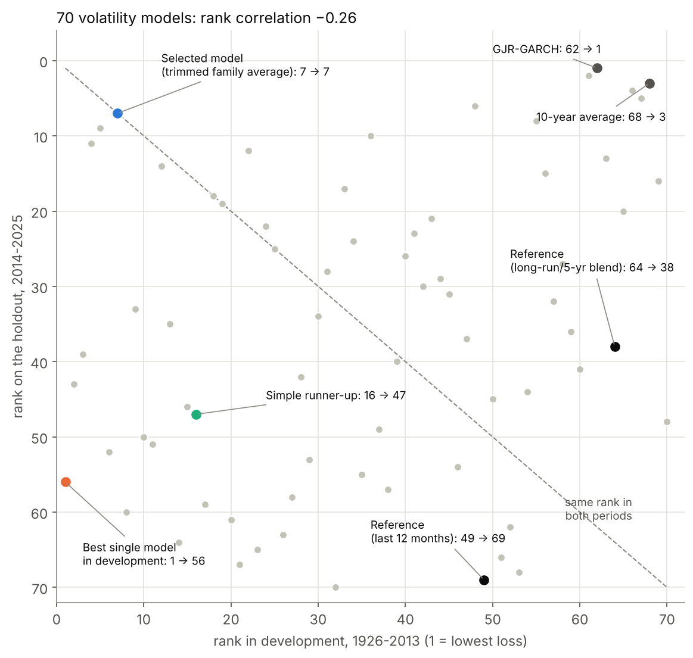
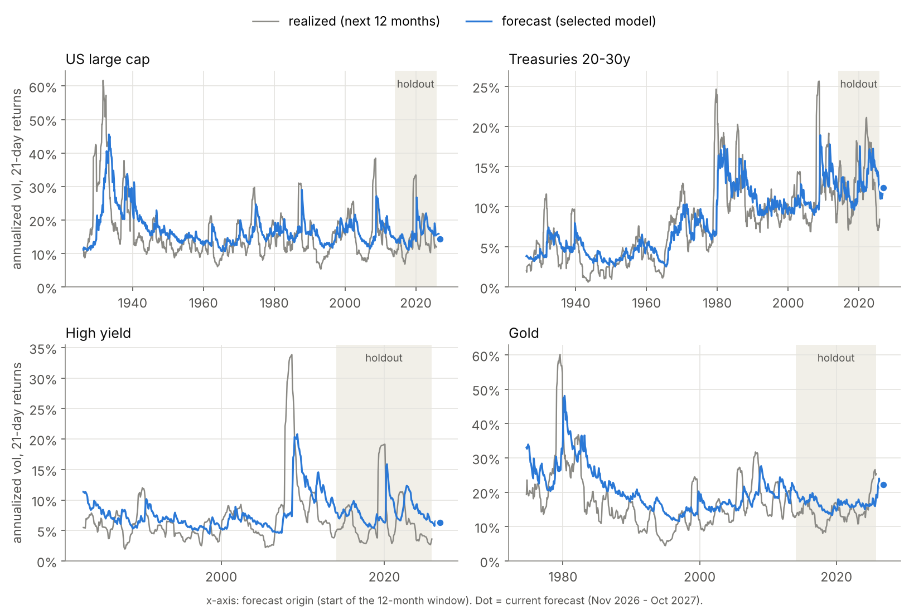
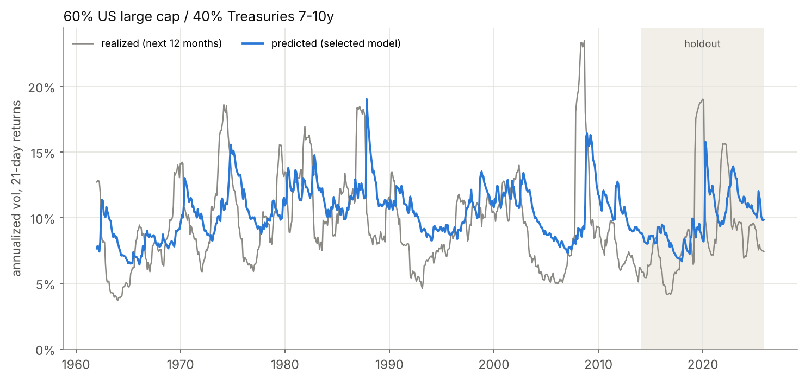
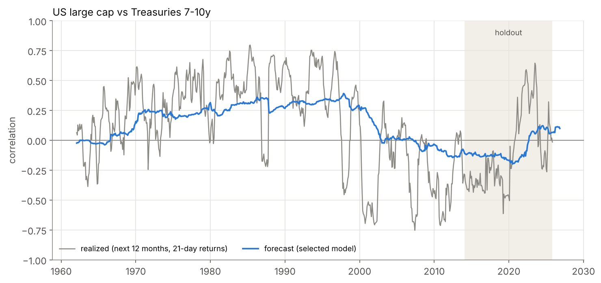

# One-year covariance forecast for twelve asset classes: final report

Forecast window: **1 November 2026 to 31 October 2027** (data through 30 October 2026).
Every number below comes from a file in this repository. The source is named where it matters.

## The answer

We built a model that forecasts the covariance matrix of twelve asset classes' returns over the next twelve months, at each month-end. We tested it on a century of history. The current forecast puts the volatility of next year's return at about:

- **16%** for US large caps, **22%** for US small caps, **17%** for international developed equities, **23%** for emerging markets;
- **8%** for intermediate Treasuries, **14%** for long Treasuries, **6%** for TIPS;
- **8%** for investment-grade credit, **6%** for high yield;
- **18%** for REITs, **24%** for gold and **19%** for commodities.

Stocks and Treasuries are forecast to be nearly uncorrelated (+0.10). A 60/40 portfolio's predicted volatility is 10.3%.

How far to trust it: **well as an average level for planning**, loosely as a prediction of any particular year.

- Over the last 30 years, realized volatility landed between about 35% below and 22% above the forecast two years in three.
- One year in twenty, it came in at more than 1.7–1.8 times the forecast.
- The model beat simple references on data it had never seen (2014–2025), but by much less than in development.
- That test period holds only about twelve independent years. It can rule out a collapse; it cannot confirm a ranking.

## 1. The forecast

### Conventions, stated once

- **Returns** are log returns in excess of T-bills, annualized. Volatility is the square root of variance.
- **Two volatilities are given for each asset.**
  - The **21-day figure** is the annualized volatility of one-month (21-trading-day) returns over the coming year. This is what the models forecast and what was scored.
  - The **12-month figure** is the volatility of the twelve-month return itself. It is larger because returns are mildly persistent beyond a month.
  - The step from one to the other (the "bridge") multiplies each variance by an estimated **variance ratio** (1.00–1.36 here). It leaves correlations unchanged.
- **These are forecasts of the mean of next year's variance.** Variance is right-skewed: most years are calmer than the forecast and a few are far worse.
  - Over 1922–2025 the median year's realized volatility came in about 16% below the forecast (about 13% below over the last 30 years).
  - Yet the forecast was right on average in variance: realized ÷ forecast variance was 1.11 in development and 1.05 on the holdout.
  - This is deliberate. An allocation model that sizes leverage on variance needs the mean, not the typical year.

### Volatility by asset

| asset | **12-month return vol** | 21-day vol | variance ratio | range across model families (21-day) | simple runner-up (21-day) | realized, last 12 months | long-run realized | history from |
|---|---|---|---|---|---|---|---|---|
| US large cap | **15.9%** | 14.4% | 1.22 | 13.8–15.0% | 14.5% | 12.0% | 15.9% | 1871 |
| US small cap | **21.5%** | 20.0% | 1.16 | 18.9–21.0% | 19.9% | 16.9% | 24.2% | 1926 |
| Intl developed equity | **16.8%** | 15.3% | 1.21 | 14.7–15.9% | 14.1% | 13.6% | 17.0% | 1975 |
| Emerging-market equity | **23.2%** | 21.5% | 1.16 | 19.8–22.7% | 21.3% | 21.2% | 22.1% | 1989 |
| Treasuries 7–10y | **7.7%** | 7.0% | 1.23 | 6.3–7.6% | 7.3% | 4.7% | 6.6% | 1953 |
| Treasuries 20–30y | **13.5%** | 12.4% | 1.19 | 11.8–13.3% | 14.3% | 8.4% | 9.3% | 1919 |
| TIPS | **5.7%** | 5.5% | 1.08 | 5.0–6.2% | 5.5% | 3.6% | 5.6% | 1997 |
| Investment-grade credit | **8.3%** | 7.2% | 1.34 | 6.4–7.8% | 8.0% | 4.9% | 5.6% | 1919 |
| High-yield credit | **6.3%** | 6.3% | 1.00 | 5.4–6.8% | 5.6% | 3.6% | 8.3% | 1980 |
| US REITs | **18.2%** | 17.5% | 1.07 | 16.6–18.2% | 17.6% | 12.7% | 17.6% | 1972 |
| Gold | **24.5%** | 22.2% | 1.21 | 20.2–24.0% | 24.6% | 25.4% | 19.6% | 1971 |
| Commodities | **19.3%** | 16.6% | 1.36 | 15.3–18.1% | 18.1% | 20.7% | 16.2% | 1926 |

How to read the table:

- **Sources.** `forecasts/latest/vols.csv`. The runner-up column is the live row of `results/final/dashboard_vol.csv`.
- **Family range.** The 10th–90th percentile of the nine model families' average forecasts. It measures how much reasonable models disagree; it is not a confidence interval for next year.
- **Last 12 months.** November 2025 to October 2026, on the 21-day basis.
- **Long-run.** The whole history, from monthly returns.


*Figure 2. Current forecast per asset. The forecast (blue dot) lies inside the spread of model families (blue bar) for every asset. Long Treasuries and IG credit are forecast well above both their long-run and last-year levels. High yield and US small caps are below their long-run levels.*

Three things stand out:

- **Bonds are forecast high.** Long Treasuries (13.5%) and IG credit (8.3%) sit far above both last year and their long-run averages. Bond volatility since 2022 has been at the high end of its history, and the model weights that slow-moving level heavily.
- **High yield is forecast low.** Its 6.3% is below its long-run 8.3%. Its variance ratio is 1.00 because the stretch of history priced like today's instrument (the HYG ETF, from 2007) is short, so the estimate is shrunk to 1.
- **Gold has the widest model disagreement** (20.2–24.0%).

### Correlations

The 21-day and 12-month correlations are identical by construction.

| | USL | USS | INT | EM | T7 | T20 | TIPS | IG | HY | REIT | GOLD |
|---|---|---|---|---|---|---|---|---|---|---|---|
| US small (USS) | 0.86 | | | | | | | | | | |
| Intl dev (INT) | 0.77 | 0.71 | | | | | | | | | |
| Emerging (EM) | 0.70 | 0.67 | 0.75 | | | | | | | | |
| Treas 7–10y (T7) | 0.10 | 0.05 | 0.14 | 0.06 | | | | | | | |
| Treas 20–30y (T20) | 0.09 | 0.06 | 0.12 | 0.06 | 0.92 | | | | | | |
| TIPS | 0.30 | 0.26 | 0.34 | 0.27 | 0.77 | 0.71 | | | | | |
| IG credit (IG) | 0.43 | 0.38 | 0.46 | 0.39 | 0.78 | 0.75 | 0.75 | | | | |
| High yield (HY) | 0.70 | 0.68 | 0.68 | 0.59 | 0.33 | 0.29 | 0.50 | 0.70 | | | |
| REITs (REIT) | 0.66 | 0.68 | 0.62 | 0.52 | 0.26 | 0.27 | 0.45 | 0.51 | 0.66 | | |
| Gold (GOLD) | 0.12 | 0.08 | 0.26 | 0.31 | 0.22 | 0.19 | 0.33 | 0.23 | 0.18 | 0.15 | |
| Commodities | 0.31 | 0.30 | 0.33 | 0.36 | −0.15 | −0.18 | 0.14 | 0.04 | 0.28 | 0.23 | 0.31 |

USL = US large cap. Source: `forecasts/latest/corr.csv`, which has four decimals.

The stock–Treasury correlation of about +0.10 sits between the strongly negative 2000–2020 regime and the positive values realized in 2022–23. Section 6 shows how poorly this number has been forecast in the past.

### Policy portfolios and downside quantiles

| portfolio | 21-day vol | 12-month return vol | 5% quantile | 1% quantile |
|---|---|---|---|---|
| 60/40 (60% US large cap, 40% Treasuries 7–10y) | 9.3% | 10.3% | −16.5% | −27.0% |
| Balanced (55% equity, 33% bonds and credit, 12% real assets) | 9.8% | 10.7% | −17.3% | −28.2% |
| All-equity (55% US large, 10% small, 25% intl, 10% EM) | 14.6% | 16.0% | −25.6% | −41.9% |

| asset | 5% | 1% | asset | 5% | 1% |
|---|---|---|---|---|---|
| US large cap | −25.5% | −41.7% | TIPS | −9.2% | −15.0% |
| US small cap | −34.6% | −56.5% | IG credit | −13.4% | −21.8% |
| Intl developed | −27.0% | −44.1% | High yield | −10.2% | −16.6% |
| Emerging | −37.2% | −60.8% | REITs | −29.2% | −47.7% |
| Treasuries 7–10y | −12.4% | −20.2% | Gold | −39.3% | −64.2% |
| Treasuries 20–30y | −21.7% | −35.5% | Commodities | −31.1% | −50.7% |

Sources: `forecasts/latest/portfolios.csv` and `vols.csv`. What the quantiles assume:

- **They exclude the mean.** They are quantiles of the 12-month **log excess return minus its mean**. **This project does not forecast expected returns.** Add your own expected log excess return to each figure.
- **The mean is treated as known.** Uncertainty about it would widen the quantiles.
- **The shape is symmetric and fat-tailed.** It is a normal distribution whose variance is itself uncertain, with kurtosis 5.3.
  - At this setting the 5% quantile is 1.61 standard deviations below the mean and the 1% quantile 2.62. For a normal they would be 1.64 and 2.33.
- **Real returns are negatively skewed, which this shape misses.** In development, assets fell below their 5% quantile 7.3% of the time and below their 1% quantile 2.0% of the time.

## 2. How to use it

**Which file.**

- Feed `forecasts/latest/cov_annual.csv` to the optimizer. It is the covariance of 12-month log excess returns, already annualized.
- `cov_21d.csv` is the same matrix on the 21-day basis.
- `forecast.json` holds everything, including the portfolio weights used above.

**Optimized portfolios: haircut their predicted risk.**

- **Fixed-weight portfolios were predicted about right.** Realized ÷ predicted variance was 0.97–1.11 in development and 1.05–1.29 on the holdout, with intervals that include 1.
- **An optimizer is different.** It seeks out the directions in which the matrix understates risk.
  - In development, the minimum-variance portfolio built from this matrix realized **1.43 times** its predicted variance (2.40 times in 2000–13).
  - Long-only minimum variance realized 1.27 times.
- **The holdout does not overturn this.** The excess disappeared there (0.83 and 1.08), but the intervals were [0.10, 1.57] and [0.29, 1.87]. That is not evidence that the problem is solved.
- **Practical rule (from the development data).** For an optimized, leveraged or long–short portfolio, scale predicted variance up by about 1.5, or constrain the optimizer with long-only or gross-exposure limits.
- **Optimized weights churn.** Unconstrained minimum variance turned over 6.6% a month one-way in development and 8.6% on the holdout. Smooth the weights or rebalance on a band.

**The one decision that is yours: how your model treats expected bond returns.**

The 12-month figures assume expected returns are constant over the long run. The bridge found that most of the extra 12-month variance of bonds (and gold) comes from decade-long drifts in returns that follow interest rates: the 1950–81 rise in yields and the fall after.

- **If your model uses a constant long-run expected return for bonds**, those drifts are genuine risk around your mean. **Use the 12-month figures as given.**
- **If your model moves expected bond returns with yields**, part of the drift is already in your mean, and counting it again double-counts it.
  - The bridge report puts the bond variance ratio at about 1.05 in that case. Treasury and IG ratios estimated on post-1985 data fall to about 0.9–1.06, against 1.19–1.34 in the default.
  - **Use the 21-day figures for the Treasury, TIPS and IG rows.** For example, 7.0% rather than 7.7% for intermediate Treasuries, and 7.2% rather than 8.3% for IG credit. This is approximately right, not exact: a ratio of 1.05 would put them about 2% higher.
  - Details: `reports/models/bridge.md`, section 3.

**What it does not give you.** Expected returns. The quantiles sit around whatever mean you supply.

## 3. Can it be trusted?

### What the model is

**The ingredients.**

- *Volatility:* nine families of models, 62 models in all:
  - simple exponentially weighted averages;
  - GARCH models;
  - regressions on recent and long-run volatility;
  - latent-volatility filters;
  - regime-switching models;
  - models using macro and option-implied data;
  - duration- and spread-based models for bonds and credit;
  - machine learning;
  - plain reference rules.
- *Correlation:* 25 correlation forecasts from five families.

**How they are combined.**

1. *Volatility.* The models within each family are averaged. Then, for each asset, the highest and lowest family averages are dropped and the remaining seven are averaged. All averaging is in variance, and no weights are estimated.
2. *Correlation.* The plain average of the 25 correlation matrices.
3. *Covariance.* The two are combined into a covariance matrix for 21-day returns. The bridge then scales each variance up to the 12-month horizon.

Internally the model is `combo_cov_main`. Its volatility part is `combo_vol_hier_trim` ("the trimmed family average") and its correlation part is `combo_corr_ew`.

**Why an average rather than the best model.**

- In development the twenty leading volatility models could not be told apart statistically. All twenty survived a test designed to keep every model that might be the best.
- Picking, each year, the model with the best record so far did worse than every average, and worse than the simplest reference.
- The trimmed family average tied the best single model on the widest sample, with the tightest confidence interval.
- It has no estimated weights, and one broken family cannot move it much.
- The cost is operational: every model family must be re-run before each forecast.

### How it was tested

- **Walk-forward from the 1920s.** At every month-end from January 1922, each model saw only the data available at that date and forecast the next twelve months. Parameters were re-estimated at most once a year.
- **A holdout that was not looked at.**
  - Development used data through 2014 only.
  - Forecasts made from January 2014 to October 2025 were scored once, at the end. That is 142 overlapping windows, about 12 independent years, including 2020 and 2022.
  - The selection and five written expectations were committed (`reports/SELECTION.md`, commit `ce8e778`) before the holdout scoring script existed. The git history shows the order.
- **An independent data audit.** It led to fixes of five defects (section 5). The most important was an investment-grade credit history partly calibrated on holdout-period data.
- **A mechanical look-ahead test.** Run each model on a panel that physically ends at a date, and check that it gives the same forecast as when the later data exist.
  - All 88 single models passed at six development dates: 528 checks, maximum difference 0.
  - The selected model, its components and the other candidates also passed at seven dates, including holdout dates: 98 checks, 0 failures.
  - The other 50-odd components of the average were tested only at development dates.
- **An independent recomputation.** Separate code recomputed 135 targets and losses; all agreed to within 3×10⁻¹¹.

**How forecasts are scored.**

- **Volatility score (QLIKE).** It compares forecast and realized variance. It is lowest on average for a forecast equal to the true mean variance, and it penalizes under-forecasts more than over-forecasts. Lower is better.
- **Skill.** The percentage reduction in that score against a comparison model.
- **Covariance score.** The multivariate version of the same idea.
- **The reference to beat** is deliberately simple: the geometric mean of each asset's whole-history variance and its last-five-years variance, combined with a ten-year correlation.

**How little a backtest can tell apart.**

- Each 12-month score overlaps the next by eleven months, so 600 monthly scores hold only about 50 independent years.
- The textbook test for comparing forecasts would declare differences that are not there about twice as often as it claims. The project replaced it with tests whose error rates were checked by simulation (`src/assetforecast/eval/inference.py`).
- The price of honest tests is low power. With about 40 years of data, a true 22% improvement is detected only about a fifth of the time at the 5% level.
- A horse race among many models will mostly fail to separate models that differ by less than 15–20%.
- On the twelve-year holdout, a true 20% difference would be detected well under half the time.

### Results

**Volatility score** (QLIKE, assets with daily data; lower is better):

| model | development, 1926–2013 | holdout, 2014–2025 |
|---|---|---|
| **Selected model** (trimmed family average) | 0.389 | **0.353** |
| Simple runner-up (section 7) | 0.402 | 0.395 |
| Best single model in development (`statespace_2c_daily`, a two-speed latent-volatility filter) | **0.360** | 0.415 |
| Reference (long-run / 5-year blend) | 0.569 | 0.383 |
| Reference (last 12 months) | 0.505 | 0.550 |

**Selected model's skill:**

| against | development [90% interval], p | holdout [90% interval], p |
|---|---|---|
| Reference (long-run / 5-year blend) | +31.7% [+19.2, +38.6], 0.012 | **+7.8% [+2.6, +29.0], 0.03** |
| Reference (last 12 months) | +23.0% [−13.5, +46.5], 0.24 | +35.9% [+17.8, +57.4], 0.06 |
| Simple runner-up | +3.2% [−16.3, +21.0], 0.76 | +10.6% [−7.6, +30.1], 0.18 |
| Best single model | −7.8% [−21.9, +7.3], 0.36 | +15.0% [unbounded, +23.7], 0.36 |

**Covariance.**

- In development the selected matrix clearly beat the reference matrix (difference in covariance score −0.316, p = 0.002).
- On the holdout it was still ahead, by about a third of that margin, but not significantly (−0.121 [−0.322, +0.079], p = 0.27).
- It tied the runner-up on the holdout (−0.623 against −0.623).

**What is established:**

- The selected model's volatilities beat the reference's in both periods.
- In development it beat the reference covariance matrix and the reference correlations.
- Fixed-weight portfolio risk was not systematically mis-predicted in either period.

**What is not established:**

- Any ranking among the selected model, the runner-up and the best single model, in either period.
- A covariance advantage over the reference on the holdout.
- Most per-asset comparisons on the holdout.

### The uncomfortable findings

**The development ranking did not survive the holdout.**

- Across all 70 volatility models (the 62 single models and 8 averages), the rank correlation between development and holdout performance is **−0.26**.
- The best single model in development ranked **56th of 70** on the holdout, behind the reference.
- A ten-year exponentially weighted average went from 68th in development to 3rd. A GJR-GARCH model went from 62nd to 1st.
- The holdout years, calm apart from two short shocks, rewarded slow forecasts.
- Only four of the 70 models beat the reference at p < 0.10 on the holdout. Three of the four are averages, including the selected model.



*Figure 3. Each dot is one of the 70 volatility models. If the development ranking had held, the dots would lie along the dashed line; they do not. The selected average was 7th in both periods; the development leader fell to 56th.*

This cuts both ways:

- **It is the strongest argument for the average that was chosen.** An investor who had picked the best backtested model in 2014 would have done worse than the reference. The average, chosen because no winner could be identified, stayed near the top.
- **It is also a warning.** A backtest leaderboard of volatility models says little about which single model to trust next.

**The lead over the simple reference narrowed out of sample**, from +31.7% to +7.8%. The reference improved a great deal in the calmer holdout (0.569 → 0.383); the selected model improved less (0.389 → 0.353).

**Two of the five expectations written before the holdout were not met.**

| # | expectation, written before the holdout | outcome |
|---|---|---|
| 1 | Volatility score better than both references | **Met.** 0.353 vs 0.383 and 0.550; no reversal |
| 2 | Covariance score better than the reference matrix | **Met in point estimate only**; not significant (p = 0.27) |
| 3 | Fixed-weight portfolios: realized ÷ predicted variance between 0.75 and 1.35 | **Met.** 60/40 1.05, balanced 1.16, risk parity 1.25, random long-only 1.19 (intervals far wider than the band) |
| 4 | Minimum-variance portfolios realize more than 1.2× their predicted variance | **Not met.** 0.83 (long-only 1.08) |
| 5 | The bridge brings standardized 12-month returns nearer unit variance | **Not met in point estimate; inconclusive.** 60/40: 0.59 without the bridge, 0.48 with it |

What the two misses mean:

- **Number 4** looks like good news: optimized-portfolio risk was not under-predicted in 2014–25. But the interval runs from 0.10 to 1.57, so the development finding (1.43) is not overturned and the haircut advice stands.
- **Number 5** says the holdout years were calmer than forecast for every policy portfolio.
  - The variance of standardized returns was 0.55–0.67 even without the bridge.
  - The bridge can only raise predicted 12-month variance, so it moved every portfolio further from 1.
  - Twelve independent years cannot settle this: the interval for 60/40 with the bridge runs from 0.26 to 1.22.
  - In development the bridge moved the balanced and all-equity portfolios nearer 1 (1.14 → 0.93 and 1.19 → 0.97), and the 60/40 slightly away (1.09 → 0.88).



*Figure 1. Forecast (blue) and realized (gray) volatility over the next 12 months for four assets, by forecast date. The forecast tracks the slow level well and misses the spikes: 1929–33 in equities, 1980 in gold, 2008 and 2020 in high yield.*



*Figure 5. Predicted against realized volatility of the 60/40 portfolio. It is about right on average (realized ÷ predicted variance 0.97 in development, 1.05 on the holdout). It sits above realized in most calm years and well below it in 2008 and 2020.*

## 4. What we learned

These findings use development data (1926–2013) unless stated. Each is limited by the low statistical power described above.

| finding | evidence |
|---|---|
| **Recent volatility matters even a year ahead, but the best memory is about a year.** | A 12-month-half-life exponential average was best. Half-lives of 6, 12 and 36 months could not be told apart (+2% to +13% worse than 12 months, p ≥ 0.16). Five years was 15–29% worse and ten years 26–51% worse. Correlations prefer a longer memory, 36–60 months. (`bench.md`) |
| **Pooling information across assets matters more than model sophistication.** | Regressions fitted per asset were clearly worse than the same regression pooled across assets (QLIKE +0.070, p = 0.085 on daily-data assets; p = 0.019 on all). The machine-learning family's value came from its pooled, normalized design, not from the learner. (`har.md`, `ml.md`) |
| **At this horizon, a slow component is what helps.** | Component GARCH beat plain GARCH by 17% (p = 0.001), and long-memory RiskMetrics by 25.5%. Asymmetric (GJR) GARCH was slightly worse than symmetric: leverage effects matter over days, not years. (`garch.md`) |
| **Macro variables and option-implied volatility added nothing detectable.** | Adding macro state to an own-history model moved the score a few percent either way, never significantly (−7%, p = 0.14, on the best base). VIX overstates the subsequent 21-day S&P variance by 82% on average, and adds nothing for equities once own history is used. (`macro.md`) |
| **Nonlinear machine learning was worse than a linear model on the same inputs.** | Gradient boosting was 19–20% worse and a random forest 46% worse than a pooled linear model (forest panel-test p = 0.02). Nothing nonlinear was significantly better. (`ml.md`) |
| **Regime switching added nothing beyond a slow average.** | The best change-point model tied a 12-month average (0.415 vs 0.409). The best Markov-switching model tied a 36-month average and was 18% worse than a 12-month one. (`regime.md`) |
| **Credit risk scales with the spread level.** | Scaling spread volatility by today's spread is what made the credit models work: investment grade +27% against the reference (p = 0.04). In December 2008 the high-yield forecast was 20%, against 9.8% for the reference. (`structural.md`) |
| **Duration × yield volatility did not beat extrapolating price volatility for Treasuries.** | The basis-point form lost at every window (intermediate −19%, long −30% against the reference). Bond volatility moved in proportion to yields when yields were high (1946–99) and in basis points when they were low (the 2000s). No fixed form captures the switch. (`structural.md`) |
| **Correlations are hard to forecast, and every candidate missed the 2021–23 stock–bond turn.** | The averaged correlation was the only forecast to beat the ten-year reference significantly in development (+4.5%, p = 0.014). On the holdout it was +1.2%, p = 0.68. For forecasts made between December 2021 and June 2023, the realized stock–bond correlation was +0.39 to +0.65; no candidate forecast more than +0.11 (Figure 4). |
| **12-month returns are more dispersed than short-horizon volatility implies.** | Every asset's raw variance ratio is above 1 (1.1–1.6). With the volatility forecast error removed, the 21-day covariance alone gave diversified portfolios' standardized 12-month returns a variance of about 1.3, with an interval excluding 1. (`bridge.md`) |
| **Learned combination weights and level calibration did not help.** | Weights fitted to past performance were no better than equal weights (−2.2%, p = 0.25). Picking the past-best family lost 15%, and the past-best model 36%. Calibrating each model's level walk-forward made 22–24 of 67 models significantly worse and only 1 significantly better. (`combo.md`) |
| **Dropping the oldest, lowest-quality history did not help.** | We removed the month-average-price eras: before 1926 for US equities and IG credit, before 1962 for Treasuries. That made 9 of the 16 models tested worse, by 0.017–0.048 QLIKE for most leaders. It left the state-space models within ±0.011, and helped only long-memory references. (`tierD_sensitivity.csv`) |



*Figure 4. Correlation of US large caps with 7–10-year Treasuries over the next 12 months, forecast against realized. The forecast is a slow average. It followed the 2000 sign change about three years late, and crossed zero again only at the end of 2022, a year after the realized correlation had turned positive.*

## 5. The data and its limits

| asset | monthly from | daily from | sources (oldest → current) |
|---|---|---|---|
| US large cap | 1871 | 1926 | Shiller month-average prices → CRSP large caps (Ken French) → SPY |
| US small cap | 1926 | 1926 | CRSP small/mid caps (Ken French) → IWM |
| Intl developed | 1975 | 1986 | Ken French EAFE → AQR global ex-US → EFA |
| Emerging markets | 1989 | 1994 | Ken French EM → Vanguard EM fund NAV → EEM |
| Treasuries 7–10y | 1953 | 1962 | bond ladder priced from Fed yields → IEF |
| Treasuries 20–30y | 1919 | 1962 | NBER long-bond yields → Fed yields → TLT |
| TIPS | 1997 | 1997 | PIMCO fund NAV → TIP |
| IG credit | 1919 | 1980 | Moody's yields → Ibbotson corporates blend → bond-fund blend → LQD |
| High yield | 1980 | 1985 | Vanguard high-yield fund NAV → HYG |
| REITs | 1972 | 1986 | Nareit index → REIT fund NAVs → VNQ |
| Gold | 1971 | 1971 | Frankfurt fixing → COMEX → GLD |
| Commodities | 1926 | 1991 | AQR equal-weight futures → Bloomberg Commodity Index |

- **Cash** is the one-month T-bill: Ken French from 1926, NBER rates before that.
- **Predictors** are 62 macro, yield-curve, credit-spread and option-implied series (VIX from 1986, MOVE from 2002). Each is stamped with the date it could first have been known.
- All sources are free and public. Source: `reports/data/panel.md`.

**The measurement problem that shaped the project.** One-day volatility depends on how a source is priced, not only on risk.

- Smoothed fund prices understate it: the high-yield fund NAV's one-day volatility is 0.54 of its 21-day volatility.
- US-listed ETFs of foreign or illiquid assets overstate it, by up to 1.20 times.
- Within one asset, the measured one-day volatility jumps by 20–50% at the splice from one kind of source to the other.
- At a 21-day horizon the sources agree. So the target is the volatility of 21-day returns, and models may use daily data only after mapping it to that scale.
- The cost is precision. A realized 12-month volatility measured this way has about 17% standard error, against about 4–5% from daily returns. This is one reason the backtest can separate only large differences. (`reports/data/horizon_evidence.md`)

**What the audit found and what was fixed** before the holdout was scored (`reports/data/audit.md`):

1. **Holdout data had leaked into IG credit history.** The investment-grade history before 2002 was calibrated against LQD over 2002–2026, so holdout data shaped history every model trained on. Pre-1980 volatility came out 11% too high. It was recalibrated on data through 2014.
2. **Six phantom distributions.** Yahoo listed six distributions for IEF and LQD in 2003 that were never paid. They made intermediate Treasuries' 2003 return +5.3% instead of about +2.4%. ETF returns are now built from close prices plus validated distributions.
3. **Income booked on one day.** Daily-accrual bond funds booked a month of income on a single day, inflating their one-day volatility by 8–25%. Income is now spread over the month.
4. **Smaller items.** Confirmed bad prints were removed and predictor publication lags corrected. A code path through which a model could have seen later predictors was found and closed; no model used it.

The correction barely moved development scores (median change 0.07–0.5%; rank correlation of the 70 models before and after 0.99). Its value was the integrity of the holdout.

**What remains imperfect, and which way it biases the forecast:**

- **High yield 1985–2007** is a smoothed mutual-fund NAV. Its 21-day volatility is about 0.83 times that of the ETF that replaced it, so 22 years of history understate high-yield volatility by about 17%, and understate its correlation with equities. This pushes the high-yield long-run level, and so its forecast, **down**.
- **Month-average-price eras** (US equities and IG credit before 1926, Treasuries before 1962) understate volatility by about 15% and add spurious persistence. Removing them did not help (section 4).
- **Smoothed or thinly traded eras** (US small caps before 2000, REIT funds before 2004) keep building variance past 21 days. The 21-day target therefore understates volatility in those eras by about 5–15%.
- **Composition changes.** Commodities before 1991 are an equal-weight basket with 0.75–0.97 times the current index's volatility. The international index for 1986–2001 includes Canada.
- **Macro series are latest-vintage**, not as first published. That would flatter the macro predictors, which added nothing anyway.

## 6. What the model cannot tell you

- **When a crisis starts.** It forecasts an average level and reacts after the fact.
  - In 2020, realized volatility came in at about two to three times the forecast in equities and credit. High yield realized 19% against a 6.3% forecast.
  - The forecast then stayed too high through 2021.
  - In 2022, rates and credit volatility ran 1.7–2.3 times the forecast.
- **Any single year with precision.**
  - Over the last 30 years, realized volatility landed between 35% below and 22% above the forecast two years in three, and between 46% below and 79% above nine years in ten.
  - About a fifth of that spread is measurement noise in the realized figure. The forecast error itself has a log standard deviation of about 0.33.
  - The band is tightest for long Treasuries (−25% to +28%) and widest for high yield (−51% to +31%) and TIPS (−40% to +41%).
  - In calm years such as 2017 and 2024, realized volatility was about half the forecast in every asset.
- **Fast correlation shifts.** The stock–bond correlation can change sign within a year; the forecast takes years to follow. On the holdout, correlation forecasts were too low by 0.04 on average, mostly because of stock–bond.
- **Much about the short-history assets.** TIPS (from 1997), emerging markets (from 1989) and high yield (ETF-priced only since 2007) rest on a few cycles. Their per-asset results are rarely significant, and their variance ratios are shrunk toward the common level.
- **A 1926–45 kind of regime.** Every averaged or slow model did badly in the Depression: QLIKE 0.637 for the selected model, against 0.418 for the plain last-12-months rule. If volatility moves far outside recent history, the forecast will follow slowly.
- **Returns.** Nothing here forecasts a mean.

## 7. Reproducing and updating

```
pip install -e ".[dev]"

# 1. Rebuild the data (optional: data/processed is committed). Needs internet; no API keys.
for t in cash_macro us_equity intl_equity treasuries tips credit reits real_assets implied; do
  python -m assetforecast.data.sources.$t
done
python -m assetforecast.data.assemble

# 2. Run every model over every month-end of the full history (writes results/full/).
scripts/run_all.sh 4                     # argument = parallel jobs

# 3. Score development and holdout (about 2.5 minutes; writes results/final/).
export OMP_NUM_THREADS=1 ASSETFORECAST_RESULTS=$PWD/results/full
python scripts/score_final.py

# 4. Produce the forecast for the latest month-end (writes forecasts/<date>/ and forecasts/latest/).
python -m assetforecast.forecast              # reads $ASSETFORECAST_RESULTS

# 5. Redraw this report's figures and the dashboard's data files.
python scripts/make_report_figures.py
python scripts/make_dashboard_data.py
```

**Step 2 is the expensive one.** The run behind this report took about 30 minutes with four parallel jobs on a four-core machine: 106 models over 1,258 month-ends. `results/full/` is not committed, so step 2 must be run before steps 3 and 4 on a fresh clone.

**Monthly update:** re-run steps 1, 2 and 4. The averaging and the bridge re-estimate themselves.

**The simple runner-up, for an independent cross-check** (`combo_cov_simple`). It can be rebuilt in an afternoon from monthly and daily excess returns alone.

- **Volatility.**
  1. For each asset, take calendar-month log excess returns r.
  2. Compute an exponentially weighted mean of r² with a 12-month half-life: weight 0.5^(age/12), with age 0 = the latest month. Do not center. Drop missing months and renormalize the weights.
  3. Forecast annual variance = 12 × that mean × c, where c is a single scale constant.
  4. Each December, re-estimate c from every past forecast whose 12-month window has ended. Take ĉ = the mean of realized ÷ forecast variance, counting each month-end once and each asset equally within it.
  5. Shrink it toward 1: c = 1 + λ(ĉ − 1), with λ = Y/(Y + 20) and Y the years of training data.
  6. Realized variance is the annualized variance of overlapping 21-day returns described in section 5. c was about 1.23 at the end of 2014.
- **Correlation.**
  1. Use an exponentially weighted correlation with a 36-month half-life, built from 21-day return sums.
  2. In each month where both assets have at least 10 complete 21-day sums, the month's co-moment is the average product of the overlapping 21-day sums. In other months, use the product of monthly returns.
  3. Compute the correlations from variances measured over the same months.
  4. Repair the matrix to positive definite: clip its eigenvalues at 0.001 and rescale to a unit diagonal.
- **What it gives up.**
  - In development: 3% on volatility (not significant), but much more in 2000–13 (0.584 against 0.415), where it was slow into and out of 2008.
  - Minimum-variance risk under-predicted by 1.71 instead of 1.43.
  - On the holdout: 10.6% behind on volatility (not significant), and tied on covariance.
- **Its current forecasts** are in the table in section 1. They differ from the selected model's by more than two percentage points only for gold (2.4 points). Long Treasuries are next at 1.9.

## Glossary

- **Holdout**: forecasts made from January 2014 to October 2025, scored only after the model was chosen.
- **Development period**: forecasts made from 1922 to December 2013, used to build and choose models.
- **Bridge / variance ratio**: the step from the volatility of 21-day returns to the volatility of the 12-month return; the variance ratio is the ratio of the two variances.
- **QLIKE**: the volatility score used throughout. Lower is better, and it is best on average for a forecast of the mean variance.
- **Model family**: a group of related models, for example all GARCH variants.

Detailed sources: `reports/SELECTION.md`, `reports/final_evaluation.md`, `reports/models/*.md`, `reports/data/*.md`, `results/final/`.
