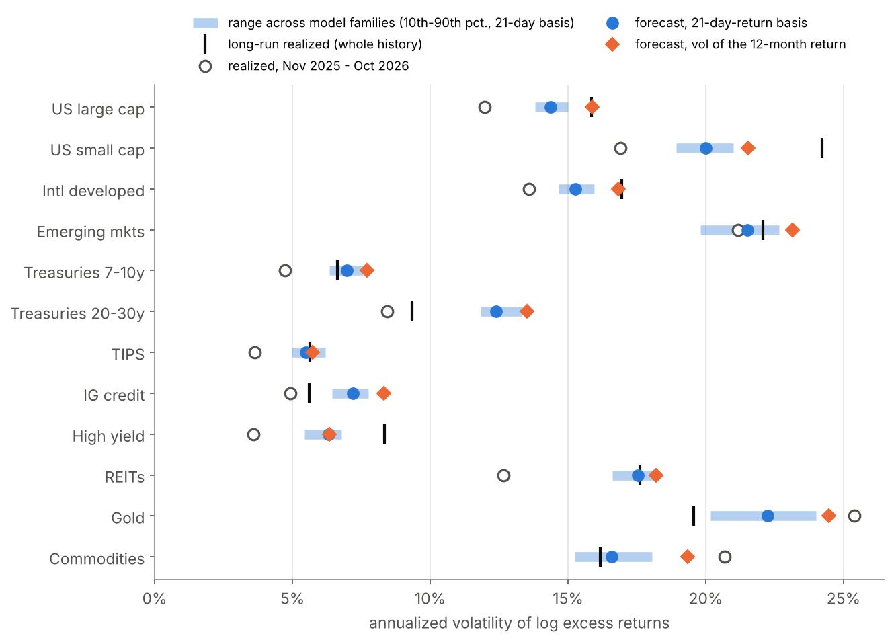

# Twelve asset classes: covariance, expected returns and the range of next year's outcomes

Forecast window: **<!-- gen:window -->November 2026 to October 2027<!-- /gen:window -->** (data through <!-- gen:data_through -->2026-10-30<!-- /gen:data_through -->).
Every number below comes from a file in this repository. Tables and the figures inside sentences marked as generated are rewritten by `python scripts/make_report_tables.py` from the same builders as the dashboard; the source is named where it matters.

## The answer

The package publishes three things for twelve asset classes and three policy portfolios, for the next twelve months:

1. **A covariance forecast.** The volatility of next year's return is forecast at:
<!-- gen:answer_vols -->
- US large-cap equity: **15.9%**
- US small-cap equity: **21.5%**
- International developed equity: **16.8%**
- Emerging-market equity: **23.2%**
- Intermediate Treasuries (~7y): **7.7%**
- Long Treasuries (~20y+): **13.5%**
- TIPS (broad): **5.7%**
- Investment-grade corporates: **8.3%**
- High-yield corporates: **6.3%**
- US REITs: **18.2%**
- Gold: **24.5%**
- Broad commodities (futures TR): **19.3%**
<!-- /gen:answer_vols -->
   The stock–Treasury correlation is forecast at <!-- gen:sb_corr -->+0.10<!-- /gen:sb_corr -->, and a 60/40 portfolio's volatility at <!-- gen:vol_6040 -->10.3<!-- /gen:vol_6040 -->%.
2. **An expected excess return per asset**: each asset's long-run historical average, with a 90% interval for that average (section 1.3). For the 60/40 portfolio it is <!-- gen:er_6040 -->+4.5<!-- /gen:er_6040 -->% (12-month log return over T-bills), with a standard error of <!-- gen:se_6040 -->1.6<!-- /gen:se_6040 --> points.
3. **A predictive distribution of next year's return**, built from the two: centred on the expected return, scaled by the volatility forecast, shaped by past outcomes (section 1.4; for the policy portfolios the published range is narrower than the volatility forecast). For the 60/40 portfolio the published 5% quantile is <!-- gen:q05_6040 -->−12.5<!-- /gen:q05_6040 -->% (<!-- gen:p6040_q05_as -->−13.1<!-- /gen:p6040_q05_as -->% with the alternative asset-based shape); it has been checked only on years already seen, and it rests on <!-- gen:episodes_p05 -->8<!-- /gen:episodes_p05 --> historical episodes.

How far to trust each part rests on three kinds of evidence, which this report keeps apart throughout:

| | what it is | genuine out-of-sample test? | where |
|---|---|---|---|
| **A. The covariance model's holdout** | forecasts made 2014–2025, scored once after the model was chosen (`results/final/`) | **yes** | section 3 |
| **B. The original return-forecasting project's holdout** | that project's own eleven assets, forecasts from 2015, at 1, 3 and 12 months (`results/archive/assetpred/`) | **yes** | section 4 |
| **C. The merge-time replication** | the same frozen models re-run on this package's twelve assets at 12 months; the published distribution's calibration; the portfolio test with this package's covariance (`results/returns/`) | **no**: both holdouts had been seen before it ran | section 5 |

The short version, as the results stand: **the volatilities are the tested part** (A: they beat a simple reference on unseen years, skill <!-- gen:cov_vol_line -->+7.8% (p = 0.034)<!-- /gen:cov_vol_line -->; the correlations, <!-- gen:cov_corr_line -->+1.2% (p = 0.682)<!-- /gen:cov_corr_line -->, and the matrix as a whole, p = <!-- gen:cov_matrix_p -->0.267<!-- /gen:cov_matrix_p -->, were ahead only in point estimate). **The expected returns are historical averages because nothing tried beat them** (B: at no horizon did a model beat the historical mean once the search over models is allowed for, and in a portfolio the model forecasts did worse than historical means). Their interval measures only how precisely history pins the average down. **The predictive ranges combine the two and have been checked only on years already seen** (C). Only forecasts made from <!-- gen:oos_from -->November 2026<!-- /gen:oos_from --> on, whose whole window lies after the two projects were combined, will be new evidence for the return side; the first of them resolves at the end of <!-- gen:first_oos_outcome -->November 2027<!-- /gen:first_oos_outcome -->.

## 1. The forecast

### 1.1 Conventions, stated once

- **Returns** are log returns in excess of T-bills, over the next twelve months. Volatility is the square root of variance. Figures are in percent.
- **Two volatilities are given for each asset.**
  - The **21-day figure** is the annualized volatility of one-month (21-trading-day) returns over the coming year. This is what the covariance models forecast and what was scored.
  - The **12-month figure** is the volatility of the twelve-month return itself. It is larger because returns are mildly persistent beyond a month.
  - The step from one to the other (the "bridge") multiplies each variance by an estimated **variance ratio**. It leaves correlations unchanged.
- **The volatility is a forecast of the mean of next year's variance.** Variance is right-skewed: most years are calmer than the forecast and a few are far worse.
  - Over 1922–2025 the median year's realized volatility came in about 16% below the forecast (about 13% below over the last 30 years).
  - Yet the forecast was right on average in variance: realized ÷ forecast variance was 1.11 in development and 1.05 on the holdout.
  - This is deliberate. An allocation model that sizes positions on variance needs the mean, not the typical year.
- **Expected returns and quantiles are of the 12-month log excess return**, and the quantiles include the mean. `expected_returns.csv` also gives the arithmetic (simple-return) equivalent, `exp(mean + variance/2) − 1`.

### 1.2 Volatility and correlation
<!-- gen:vol_table -->
| asset | **12-month return vol** | 21-day vol | variance ratio | range across model families (21-day) | simple runner-up (21-day) | realized, last 12 months | long-run realized | history from |
|---|---|---|---|---|---|---|---|---|
| US large-cap equity | **15.9%** | 14.4% | 1.22 | 13.8–15.0% | 14.5% | 12.0% | 15.9% | 1871 |
| US small-cap equity | **21.5%** | 20.0% | 1.16 | 18.9–21.0% | 19.9% | 16.9% | 24.2% | 1926 |
| International developed equity | **16.8%** | 15.3% | 1.21 | 14.7–15.9% | 14.1% | 13.6% | 17.0% | 1975 |
| Emerging-market equity | **23.2%** | 21.5% | 1.16 | 19.8–22.7% | 21.3% | 21.2% | 22.1% | 1989 |
| Intermediate Treasuries (~7y) | **7.7%** | 7.0% | 1.23 | 6.3–7.6% | 7.3% | 4.7% | 6.6% | 1953 |
| Long Treasuries (~20y+) | **13.5%** | 12.4% | 1.19 | 11.8–13.3% | 14.3% | 8.4% | 9.3% | 1919 |
| TIPS (broad) | **5.7%** | 5.5% | 1.08 | 5.0–6.2% | 5.5% | 3.6% | 5.6% | 1997 |
| Investment-grade corporates | **8.3%** | 7.2% | 1.34 | 6.4–7.8% | 8.0% | 4.9% | 5.6% | 1919 |
| High-yield corporates | **6.3%** | 6.3% | 1.00 | 5.4–6.8% | 5.6% | 3.6% | 8.3% | 1980 |
| US REITs | **18.2%** | 17.5% | 1.07 | 16.6–18.2% | 17.6% | 12.7% | 17.6% | 1972 |
| Gold | **24.5%** | 22.2% | 1.21 | 20.2–24.0% | 24.6% | 25.4% | 19.6% | 1971 |
| Broad commodities (futures TR) | **19.3%** | 16.6% | 1.36 | 15.3–18.1% | 18.1% | 20.7% | 16.2% | 1926 |
<!-- /gen:vol_table -->
How to read the table:

- **Sources.** `forecasts/latest/vols.csv`. The runner-up column is the live row of `results/final/dashboard_vol.csv`.
- **Family range.** The 10th–90th percentile of the nine model families' average forecasts. It measures how much reasonable models disagree; it is not a confidence interval for next year.
- **Last 12 months** is on the 21-day basis; **long-run** is the whole history, from monthly returns.
- High yield's variance ratio is shrunk toward 1 because the stretch of history priced like today's instrument (the HYG ETF, from 2007) is short.



*Figure 2. Volatility forecast per asset (blue dot) against the spread of model families (blue bar), last year's and the long-run realized volatility, as drawn by `scripts/make_report_figures.py` at the forecast date.*

**Correlations.** The 21-day and 12-month correlations are identical by construction. Source: `forecasts/latest/corr.csv`, which has four decimals.
<!-- gen:corr_table -->
|  | US large | US small | Intl dev | EM | UST 7y | UST 20y | TIPS | IG credit | High yield | REITs | Gold |
|---|---|---|---|---|---|---|---|---|---|---|---|
| US small | 0.86 |  |  |  |  |  |  |  |  |  |  |
| Intl dev | 0.77 | 0.71 |  |  |  |  |  |  |  |  |  |
| EM | 0.70 | 0.67 | 0.75 |  |  |  |  |  |  |  |  |
| UST 7y | 0.10 | 0.05 | 0.14 | 0.06 |  |  |  |  |  |  |  |
| UST 20y | 0.09 | 0.06 | 0.12 | 0.06 | 0.92 |  |  |  |  |  |  |
| TIPS | 0.30 | 0.26 | 0.34 | 0.27 | 0.77 | 0.71 |  |  |  |  |  |
| IG credit | 0.43 | 0.38 | 0.46 | 0.39 | 0.78 | 0.75 | 0.75 |  |  |  |  |
| High yield | 0.70 | 0.68 | 0.68 | 0.59 | 0.33 | 0.29 | 0.50 | 0.70 |  |  |  |
| REITs | 0.66 | 0.68 | 0.62 | 0.52 | 0.26 | 0.27 | 0.45 | 0.51 | 0.66 |  |  |
| Gold | 0.12 | 0.08 | 0.26 | 0.31 | 0.22 | 0.19 | 0.33 | 0.23 | 0.18 | 0.15 |  |
| Commod. | 0.31 | 0.30 | 0.33 | 0.36 | −0.15 | −0.18 | 0.14 | 0.04 | 0.28 | 0.23 | 0.31 |
<!-- /gen:corr_table -->
Section 3 shows how poorly the stock–Treasury correlation has been forecast in the past.

### 1.3 Expected returns
<!-- gen:outlook_table -->
| asset | **expected return** | 90% interval | arithmetic equivalent | 12-month vol | 1% | 5% | median | 95% | 99% | average since |
|---|---|---|---|---|---|---|---|---|---|---|
| US large-cap equity | **+6.5%** | 3.0 to 9.9% | 8.0% | 15.9% | −41.1 | −20.6 | 7.4 | 32.7 | 43.6 | 1926-07 |
| US small-cap equity | **+7.7%** | 3.3 to 12.0% | 10.5% | 21.5% | −56.8 | −29.0 | 8.9 | 43.2 | 58.0 | 1926-07 |
| International developed equity | **+4.7%** | 0.0 to 9.4% | 6.3% | 16.8% | −45.8 | −24.0 | 5.7 | 32.6 | 44.2 | 1975-01 |
| Emerging-market equity | **+5.3%** | −0.4 to 10.9% | 8.3% | 23.2% | −64.1 | −34.2 | 6.6 | 43.5 | 59.4 | 1989-07 |
| Intermediate Treasuries (~7y) | **+1.5%** | −0.3 to 3.4% | 1.8% | 7.7% | −21.6 | −11.6 | 2.0 | 14.3 | 19.6 | 1962-02 |
| Long Treasuries (~20y+) | **+1.5%** | −1.3 to 4.2% | 2.4% | 13.5% | −38.9 | −21.5 | 2.2 | 23.8 | 33.0 | 1962-02 |
| TIPS (broad) | **+2.3%** | −0.3 to 5.0% | 2.5% | 5.7% | −15.2 | −7.6 | 2.7 | 12.0 | 16.0 | 1997-02 |
| Investment-grade corporates | **+1.7%** | 0.5 to 2.9% | 2.1% | 8.3% | −23.1 | −12.4 | 2.2 | 15.4 | 21.1 | 1926-07 |
| High-yield corporates | **+3.2%** | 1.3 to 5.2% | 3.5% | 6.3% | −15.9 | −7.6 | 3.6 | 13.8 | 18.2 | 1980-02 |
| US REITs | **+5.9%** | 2.2 to 9.5% | 7.8% | 18.2% | −48.5 | −25.0 | 6.9 | 35.9 | 48.3 | 1972-01 |
| Gold | **+3.8%** | −1.8 to 9.4% | 7.0% | 24.5% | −69.4 | −37.8 | 5.2 | 44.2 | 61.0 | 1971-09 |
| Broad commodities (futures TR) | **+3.2%** | −0.3 to 6.7% | 5.2% | 19.3% | −54.5 | −29.6 | 4.3 | 35.1 | 48.3 | 1926-07 |
<!-- /gen:outlook_table -->
Sources: `forecasts/latest/expected_returns.csv` and `distribution_assets.csv`; definitions in `src/assetforecast/returns/expected.py`.

<!-- gen:er_zero_line -->6 of the 12 90% intervals include zero, and the lower bound for International developed equity is essentially zero<!-- /gen:er_zero_line -->: for those assets, history alone cannot say that they earn more than T-bills.

- **What the number is.** Twelve times the asset's average monthly log excess return over its whole history through the forecast date, on the return panel: from <!-- gen:return_panel_from -->July 1926<!-- /gen:return_panel_from --> (or the asset's first month, if later), without the month-average price eras. It is the same number as the `hist_mean` benchmark of section 4. It is the expected return because nothing better was found, not because it was shown to be a good forecast.
- **What the interval is.** A 90% interval for the average itself, with a standard error that allows for serial correlation in monthly returns and a Student-t reference that pays for estimating it (the rule was chosen on simulated data before any real interval was looked at). With thirty years of history it is wide; with a century it is narrower.
- **What the interval is not.** It does not cover an average that has changed over time: the secular fall in yields behind forty years of bond returns, a change in the equity premium, or the choice of start date. It is the sampling error of an average of the history at hand, nothing more.
- **The histories differ by asset.** Emerging markets from 1989 and TIPS from 1997 rest on one or two cycles; US large caps and IG credit on a century. The covariance side uses longer histories still (US large caps from 1871), including the month-average eras the return side drops.

### 1.4 Predictive distributions

**How they are built** (`src/assetforecast/returns/distribution.py`, model `dist_hm_af`):

- **Centre**: the expected return of section 1.3.
- **Scale**: the 12-month volatility forecast, widened by the expected return's own standard error: `sqrt(variance + se²)`.
- **Shape**: quantiles of past 12-month outcomes, each measured in units of the scale that was forecast at the time, pooled across assets over every window that had closed by the forecast date; recentred so the distribution stays centred on the historical mean; with the 1%, 5%, 95% and 99% points no thinner than a normal of the same spread.
- **Policy portfolios** use the same recipe with a shape pooled over the three portfolios' own past outcomes. Their log return is approximated by the weighted sum of the assets' log returns, as in the covariance side's portfolio tests (this omits a diversification return of a fraction of a percent a year).
<!-- gen:portfolio_table -->
| portfolio | shape | expected return (s.e.) | 21-day vol | 12-month vol | sd of the range | 1% | 5% | median | 95% | 99% |
|---|---|---|---|---|---|---|---|---|---|---|
| 60/40 (US large cap / intermediate Treasuries) | published (portfolio outcomes) | +4.5% (1.6) | 9.3% | 10.3% | 9.5% | −27.1 | −12.5 | 6.3 | 20.2 | 26.7 |
| Balanced 12-asset mix | published (portfolio outcomes) | +4.4% (2.0) | 9.8% | 10.7% | 10.0% | −28.7 | −13.4 | 6.3 | 20.9 | 27.7 |
| Global equity mix | published (portfolio outcomes) | +6.0% (2.3) | 14.6% | 16.0% | 14.8% | −42.9 | −20.3 | 8.8 | 30.3 | 40.4 |
| *60/40 (US large cap / intermediate Treasuries)* | *sensitivity (asset outcomes)* | +4.5% (1.6) | 9.3% | 10.3% | 10.4% | −26.5 | −13.1 | 5.1 | 21.6 | 28.7 |
| *Balanced 12-asset mix* | *sensitivity (asset outcomes)* | +4.4% (2.0) | 9.8% | 10.7% | 10.9% | −28.0 | −14.0 | 5.0 | 22.3 | 29.7 |
| *Global equity mix* | *sensitivity (asset outcomes)* | +6.0% (2.3) | 14.6% | 16.0% | 16.1% | −41.9 | −21.2 | 7.0 | 32.5 | 43.5 |
<!-- /gen:portfolio_table -->
Weights:
<!-- gen:portfolio_weights -->
- 60/40 (US large cap / intermediate Treasuries): 60% US large, 40% UST 7y
- Balanced 12-asset mix: 30% US large, 5% US small, 15% Intl dev, 5% EM, 15% UST 7y, 5% UST 20y, 5% TIPS, 5% IG credit, 3% High yield, 4% REITs, 4% Gold, 4% Commod.
- Global equity mix: 55% US large, 10% US small, 25% Intl dev, 10% EM
<!-- /gen:portfolio_weights -->
Sources: `forecasts/latest/distribution_portfolios.csv` (rows with `shape = portfolios` are published; `shape = assets` is the sensitivity check) and `shape.csv`; the expected return's standard error (s.e.) is `se` in `results/returns/distribution/residuals.parquet` at the forecast origin. A portfolio's s.e. adds the assets' standard errors weighted by the absolute weights, as if their errors were perfectly correlated; no interval is published for it.

**The published portfolio ranges are narrower than the package's own covariance forecast.** <!-- gen:port_narrow_line -->the portfolio shape keeps the spread of past portfolio outcomes, 0.916 of the scale then predicted (from 3 overlapping portfolio series), and its tails are floored at a normal with that same spread, not unit spread. For 60/40 the range's standard deviation is 9.55% against a 12-month volatility forecast of 10.30%; its middle half (25–75%) is 24% narrower than a normal at the predictive scale; and its 95% and 99% quantiles sit on the narrower floor<!-- /gen:port_narrow_line -->. The asset-shape rows do not narrow this way. The method is unchanged pending the owner's decision on which row to publish as the headline; until then, read the two rows together.

**What "policy portfolios" means in early years.** The portfolio shape pools past outcomes of the three policy mixes. Before every asset's history begins, each mix is its policy weights renormalized over the assets then available (a mix is skipped when one of its required assets is missing), so the early outcomes behind the shape are of smaller, more concentrated portfolios.

**The shape** (standardized quantiles, pooled, beside the normal):
<!-- gen:shape_table -->
| quantile | 1% | 5% | 10% | 25% | 50% | 75% | 90% | 95% | 99% |
|---|---|---|---|---|---|---|---|---|---|
| single assets | −2.97 | −1.69 | −1.21 | −0.57 | 0.06 | 0.64 | 1.14 | 1.64 | 2.32 |
| policy portfolios | −3.03 | −1.63 | −1.21 | −0.44 | 0.17 | 0.59 | 0.95 | 1.51 | 2.13 |
| normal | −2.33 | −1.65 | −1.28 | −0.67 | 0.00 | 0.67 | 1.28 | 1.65 | 2.33 |
<!-- /gen:shape_table -->
**What the portfolio tails rest on.** Portfolio outcomes overlap by eleven months in twelve and the three portfolios fall together, so the portfolio shape's 1% and 5% points rest on only <!-- gen:episodes_p -->3 and 8<!-- /gen:episodes_p --> separate historical episodes (the asset shape on <!-- gen:episodes_a -->10 and 22<!-- /gen:episodes_a -->). This is why the asset-shape version is published beside it: the gap between the two rows is a fair measure of how uncertain the portfolio tails are. Neither says when a bad year comes.

## 2. How to use the three outputs together

The package does **no position sizing**. It publishes inputs; the sizing decision belongs to the allocation model. These are the ways of using them that the evidence supports.

**Which file.**

- `forecasts/latest/cov_annual.csv`: the covariance of 12-month log excess returns, already annualized. Feed this to the optimizer.
- `forecasts/latest/expected_returns.csv`: `mean_12m` (log) with `ci90_lo`/`ci90_hi`, and `mean_12m_arith` for an optimizer that works in simple returns.
- `forecasts/latest/distribution_assets.csv`, `distribution_portfolios.csv`: quantiles of next year's return, including the mean, for stress tests and drawdown limits.
- `forecast.json` holds everything, with the method of each block and the portfolio weights.

**Treat the expected returns as a weak prior, not a signal.** No model beat them, but that does not show them to be accurate: sections 4 and 5 compare models with the historical mean, not the historical mean with the truth. Their intervals are wide relative to the differences between many assets, which an optimizer fed point means will treat as real. Shrink the means toward each other, constrain the weights, or check that the allocation survives means drawn from inside the intervals.

**Haircut the risk of optimized portfolios.**

- **Fixed-weight portfolios were predicted about right.** Realized ÷ predicted variance was 0.97–1.11 in development and 1.05–1.29 on the holdout, with intervals that include 1.
- **An optimizer is different.** It seeks out the directions in which the matrix understates risk. In development, the minimum-variance portfolio built from this matrix realized **1.43 times** its predicted variance (2.40 times in 2000–13); long-only minimum variance realized 1.27 times.
- **The holdout does not overturn this.** The excess disappeared there (0.83 and 1.08), but the intervals were [0.10, 1.57] and [0.29, 1.87].
- **Practical rule (from the development data).** For an optimized or long–short portfolio, scale predicted variance up by about 1.5, or constrain the optimizer with long-only or gross-exposure limits.
- **Optimized weights churn.** Unconstrained minimum variance turned over 6.6% a month one-way in development and 8.6% on the holdout. Smooth the weights or rebalance on a band.

**Use the distribution for the downside, with the sensitivity row.** For a risk limit set on a bad-year loss, read the 5% and 1% quantiles of the portfolio actually held. For the policy mixes, use the more severe of the published and asset-shape rows; the published row is the narrower of the two (section 1.4). **For any other portfolio, and for anything optimized, use the asset-pooled shape** (`shape.csv`, column `z_assets`) on the covariance-implied scale: `w'mean + sqrt(k·w'Σw + (Σ|w|·se)²) × z_assets`, with `k` the variance haircut above (about 1.5 for optimized portfolios, 1 for a fixed mix). Do not use `z_portfolios` for such portfolios: it carries the narrower spread of three past policy mixes. The package does not publish quantiles for arbitrary weights.

**The one decision that is yours: how your model treats expected bond returns.** The 12-month variances assume expected returns are constant over the long run, which is exactly what the published expected returns are. The bridge found that most of the extra 12-month variance of bonds (and gold) comes from decade-long drifts in returns that follow interest rates.

- **If you use the published (constant) expected returns**, those drifts are genuine risk around your mean. **Use the 12-month figures as given.**
- **If you replace them with expected bond returns that move with yields**, part of the drift is already in your mean, and counting it again double-counts it. The bridge report puts the bond variance ratio at about 1.05 in that case; use the 21-day figures for the Treasury, TIPS and IG rows (approximately right, not exact). Details: `reports/models/bridge.md`, section 3.

## 3. Can the covariance forecast be trusted? (evidence A)

### What the model is

**The ingredients.**

- *Volatility:* nine families of models, 62 models in all: simple exponentially weighted averages; GARCH models; regressions on recent and long-run volatility; latent-volatility filters; regime-switching models; models using macro and option-implied data; duration- and spread-based models for bonds and credit; machine learning; plain reference rules.
- *Correlation:* 25 correlation forecasts from five families.

**How they are combined.**

1. *Volatility.* The models within each family are averaged. Then, for each asset, the highest and lowest family averages are dropped and the remaining seven are averaged. All averaging is in variance, and no weights are estimated.
2. *Correlation.* The plain average of the 25 correlation matrices.
3. *Covariance.* The two are combined into a covariance matrix for 21-day returns. The bridge then scales each variance up to the 12-month horizon.

Internally the model is `combo_cov_main`. Its volatility part is `combo_vol_hier_trim` ("the trimmed family average") and its correlation part is `combo_corr_ew`. The same model's forecast at every past month-end, 21-day and 12-month, is in `results/covariance/cov_history.parquet` (`python -m assetforecast.covhistory`); the return side uses it. During the merge the regenerated model forecasts were re-scored to a scratch directory (`OMP_NUM_THREADS=1 ASSETFORECAST_RESULTS=$PWD/results/full python scripts/score_final.py --out <scratch dir>`): 24 of the 25 CSV files matched the committed `results/final/` byte for byte, `summary.json` matched in every numeric field, and the 25th file, `data_correction.csv`, could not be produced because it compares against development results of the earlier covariance project that were never committed. No test in the repository repeats this check.

**Why an average rather than the best model.**

- In development the twenty leading volatility models could not be told apart statistically. All twenty survived a test designed to keep every model that might be the best.
- Picking, each year, the model with the best record so far did worse than every average, and worse than the simplest reference.
- The trimmed family average tied the best single model on the widest sample, with the tightest confidence interval.
- It has no estimated weights, and one broken family cannot move it much.
- The cost is operational: every model family must be re-run before each forecast.

### How it was tested

- **Walk-forward from the 1920s.** At every month-end from January 1922, each model saw only the data available at that date and forecast the next twelve months. Parameters were re-estimated at most once a year.
- **A holdout that was not looked at.**
  - Development used data through 2014 only.
  - Forecasts made from January 2014 to October 2025 were scored once, at the end. That is 142 overlapping windows, about 12 independent years, including 2020 and 2022.
  - The selection and five written expectations were committed (`reports/SELECTION.md`, commit `ce8e778`) before the holdout scoring script existed. The git history shows the order.
- **An independent data audit.** It led to fixes of five defects (section 7). The most important was an investment-grade credit history partly calibrated on holdout-period data.
- **A mechanical look-ahead test.** Run each model on a panel that physically ends at a date, and check that it gives the same forecast as when the later data exist. All 88 single models passed at six development dates (528 checks, maximum difference 0); the selected model, its components and the other candidates also passed at seven dates, including holdout dates (98 checks, 0 failures). The other 50-odd components of the average were tested only at development dates.
- **An independent recomputation.** Separate code recomputed 135 targets and losses; all agreed to within 3×10⁻¹¹.

**How forecasts are scored.**

- **Volatility score (QLIKE).** It compares forecast and realized variance. It is lowest on average for a forecast equal to the true mean variance, and it penalizes under-forecasts more than over-forecasts. Lower is better.
- **Skill.** The percentage reduction in that score against a comparison model.
- **Covariance score.** The multivariate version of the same idea.
- **The reference to beat** is deliberately simple: the geometric mean of each asset's whole-history variance and its last-five-years variance, combined with a ten-year correlation.

**How little a backtest can tell apart.**

- Each 12-month score overlaps the next by eleven months, so 600 monthly scores hold only about 50 independent years.
- The textbook test for comparing forecasts would declare differences that are not there about twice as often as it claims. The project replaced it with tests whose error rates were checked by simulation (`src/assetforecast/eval/inference.py`).
- The price of honest tests is low power. With about 40 years of data, a true 22% improvement is detected only about a fifth of the time at the 5% level. On the twelve-year holdout, a true 20% difference would be detected well under half the time.

### Results

**Volatility score** (QLIKE, assets with daily data; lower is better; `results/final/summary.json`):
<!-- gen:cov_scores -->
| model | development, 1926–2013 | holdout, 2014–2025 |
|---|---|---|
| **Selected model** (trimmed family average) | 0.389 | 0.353 |
| Simple runner-up (section 9) | 0.402 | 0.395 |
| Best single model in development (`statespace_2c_daily`) | 0.360 | 0.415 |
| Reference (long-run / 5-year blend) | 0.569 | 0.383 |
| Reference (last 12 months) | 0.505 | 0.550 |
<!-- /gen:cov_scores -->
**Selected model's skill** (positive favours the selected model; a lower bound below −100% means the interval is unbounded):
<!-- gen:cov_skill -->
| against | development [90% interval], p | holdout [90% interval], p |
|---|---|---|
| Reference (long-run / 5-year blend) | +31.7% [+19.2, +38.6], 0.01 | +7.8% [+2.6, +29.0], 0.03 |
| Reference (last 12 months) | +23.0% [−13.5, +46.5], 0.24 | +35.9% [+17.8, +57.4], 0.06 |
| Simple runner-up (section 9) | +3.3% [−16.3, +21.0], 0.76 | +10.6% [−7.6, +30.1], 0.18 |
| Best single model in development (`statespace_2c_daily`) | −7.8% [−21.9, +7.3], 0.36 | +15.0% [unbounded, +23.7], 0.36 |
<!-- /gen:cov_skill -->
**Covariance.** Against the reference matrix: <!-- gen:cov_matrix_line -->development difference in covariance loss −0.316 (p = 0.002); holdout −0.121 [−0.322, +0.079] (p = 0.27)<!-- /gen:cov_matrix_line -->. On the holdout the selected matrix was still ahead, by about a third of its development margin, but not significantly; it tied the runner-up.

**Correlations.** The averaged correlation forecast against the ten-year reference correlation, holdout skill: <!-- gen:cov_corr_line -->+1.2% (p = 0.682)<!-- /gen:cov_corr_line -->: ahead only in point estimate. In development it was the only correlation forecast to beat the reference significantly (section 6).

**What is established:** the selected model's volatilities beat the reference's in both periods; in development it beat the reference covariance matrix and the reference correlations; fixed-weight portfolio risk was not systematically mis-predicted in either period.

**What is not established:** a correlation or whole-matrix advantage over the references on the holdout; any ranking among the selected model, the runner-up and the best single model, in either period; most per-asset comparisons on the holdout.

### The uncomfortable findings

**The development ranking did not survive the holdout.**

- Across all 70 volatility models (the 62 single models and 8 averages), the rank correlation between development and holdout performance is **−0.26**.
- The best single model in development ranked **56th of 70** on the holdout, behind the reference. A ten-year exponentially weighted average went from 68th in development to 3rd; a GJR-GARCH model from 62nd to 1st.
- The holdout years, calm apart from two short shocks, rewarded slow forecasts. Only four of the 70 models beat the reference at p < 0.10 on the holdout; three of the four are averages, including the selected model.


*Figure 3. Each dot is one of the 70 volatility models. If the development ranking had held, the dots would lie along the dashed line; they do not. The selected average was 7th in both periods; the development leader fell to 56th.*

This cuts both ways. It is the strongest argument for the average that was chosen: an investor who had picked the best backtested model in 2014 would have done worse than the reference. It is also a warning: a backtest leaderboard of volatility models says little about which single model to trust next. The return side teaches the same lesson (section 4).

**The lead over the simple reference narrowed out of sample.** The reference improved a great deal in the calmer holdout; the selected model improved less.

**Two of the five expectations written before the holdout were not met** (`results/final/expectations.csv`, reworded; numbers as the scoring script wrote them, 90% intervals in brackets):
<!-- gen:expectations_table -->
| # | expectation, written before the holdout | outcome | evidence |
|---|---|---|---|
| 1 | The selected model's volatility loss (QLIKE) below the best reference (last-12-months reference, long-run/5-year reference) on the holdout | **Met** | Holdout loss: selected 0.353 vs last-12-months reference 0.550, skill +35.9% [+17.8, +57.4], p=0.06; holdout loss: selected 0.353 vs long-run/5-year reference 0.383, skill +7.8% [+2.6, +29.0], p=0.03; development: vs last-12-months reference +23.0% [-13.5, +46.5]; vs long-run/5-year reference +31.7% [+19.2, +38.6] |
| 2 | The selected model's covariance loss below the reference matrix on the holdout | **Met (point estimate; not significant)** | Holdout covariance loss -0.623 vs -0.502, difference -0.121 [-0.322, +0.079], p=0.267, n=142; development difference -0.316 p=0.002 |
| 3 | Fixed-weight portfolios (60/40, balanced, risk parity, random): mean realized/predicted variance in [0.75, 1.35] on the holdout | **Met** | 60/40 1.05 [0.40, 1.70] (development 0.97); balanced 1.16 [0.30, 2.02] (development 1.06); risk parity 1.25 [0.44, 2.06] (development 1.10); random 1.19 [0.36, 2.01] (development 1.03) |
| 4 | Minimum-variance portfolios realize more variance than predicted, factor > 1.2 | **Not met** | Minimum variance 0.83 [0.10, 1.57] (development 1.43); long-only minimum variance 1.08 [0.29, 1.87] (development 1.27) |
| 5 | With the bridge, the variance of standardized 12-month returns of policy portfolios nearer 1 than without | **Not met in point estimate (with the bridge further from 1 for all); inconclusive statistically** | 60/40: without the bridge 0.59 [0.27, 1.20], with the bridge 0.48 [0.21, 0.97], chance range for 12 independent years [0.26, 1.22]; balanced: without the bridge 0.67 [0.37, 1.21], with the bridge 0.55 [0.32, 0.98], chance range for 12 independent years [0.30, 1.40]; all-equity: without the bridge 0.55 [0.37, 0.84], with the bridge 0.45 [0.32, 0.69], chance range for 12 independent years [0.25, 1.14] |
<!-- /gen:expectations_table -->
What the two misses mean:

- **Number 4** looks like good news: optimized-portfolio risk was not under-predicted in 2014–25. But the interval is wide enough that the development finding is not overturned, and the haircut advice stands.
- **Number 5** says the holdout years were calmer than forecast for every policy portfolio. The bridge can only raise predicted 12-month variance, so it moved every portfolio further from 1. Twelve independent years cannot settle this. In development the bridge moved the balanced and all-equity portfolios nearer 1 (1.14 → 0.93 and 1.19 → 0.97), and the 60/40 slightly away (1.09 → 0.88).


*Figure 1. Forecast (blue) and realized (gray) volatility over the next 12 months for four assets, by forecast date. The forecast tracks the slow level well and misses the spikes: 1929–33 in equities, 1980 in gold, 2008 and 2020 in high yield.*


*Figure 5. Predicted against realized volatility of the 60/40 portfolio. It is about right on average, sits above realized in most calm years and well below it in 2008 and 2020.*


*Figure 4. Correlation of US large caps with 7–10-year Treasuries over the next 12 months, forecast against realized. The forecast is a slow average. It followed the 2000 sign change about three years late, and crossed zero again only at the end of 2022, a year after the realized correlation had turned positive.*

## 4. Evidence B: the original return-forecasting project's holdout (out of sample)

The return side comes from a separate project (`assetpred`), commissioned to ask whether machine learning over price, valuation, carry, macro and sentiment predictors could forecast asset-class excess returns better than each asset's historical mean, at 1, 3 and 12 months. Its README at the time of the merge is `git show 25a955d:ASSETPRED.md`; its results are archived unchanged in `results/archive/assetpred/`. **Everything in this section is that project's own holdout, a genuine out-of-sample test.** Nothing produced during the merge appears here; that is section 5.

Models were developed on forecasts whose outcomes were known by the end of 2014. The model lists, the test families and the scoring rules were then frozen, and forecasts made from January 2015 on were scored once. Its panel had eleven assets, not twelve (no US small caps; gold from December 2004; IG credit a long-duration fund from 1980), so its numbers are not on this package's panel.

### 4.1 Expected returns

Six frozen models (ridge regression, a forecast combination, gradient boosting, a random forest, their ensemble, and boosting on price predictors only) against the expanding historical mean. R² is the share of the historical mean's squared error a model removed, pooled over assets; the family test asks whether the best of the six beats the mean, allowing for the search over them; "R² detectable" is roughly what the sample's independent observations could have detected. "Not significant" means the best model's R² was positive but the family test did not confirm it; "no edge" is kept for a best R² that is not positive.
<!-- gen:mean_table_orig -->
| test | origins | best model | best pooled R² | models with R² > 0 | R² detectable | family test p | independent obs. | verdict |
|---|---|---|---|---|---|---|---|---|
| Original holdout, 1 month | 2015-01 to 2026-09 | Gradient boosting | +0.10% | 3 of 6 | 1.9% | 0.554 | 141.0 | not significant |
| Original holdout, 3 months | 2015-01 to 2026-07 | Forecast combination | +0.41% | 1 of 6 | 5.5% | 0.351 | 46.3 | not significant |
| Original holdout, 12 months | 2015-01 to 2025-10 | Forecast combination | +2.21% | 3 of 6 | 20.0% | 0.267 | 10.8 | not significant |
<!-- /gen:mean_table_orig -->
Per model:
<!-- gen:mean_models_orig -->
| model (pooled R² vs historical mean) | orig. 1m | orig. 3m | orig. 12m |
|---|---|---|---|
| Ridge regression | −0.29% | −0.33% | −0.39% |
| Forecast combination | +0.09% | +0.41% | +2.21% |
| Gradient boosting | +0.10% | −0.07% | −0.12% |
| Random forest | +0.06% | −0.01% | +0.03% |
| Ensemble | −0.01% | −0.24% | −1.06% |
| Boosting, price predictors only | −0.61% | −0.07% | +0.32% |
| Boosting without hindsight features *(robustness)* | +0.33% | +0.04% | −0.04% |
| Combination without hindsight features *(robustness)* | +0.09% | +0.43% | +2.23% |
<!-- /gen:mean_models_orig -->
(Source: `results/archive/assetpred/scores/frozen.parquet`. The robustness rows drop features estimated over the full sample and are in no test family.)

### 4.2 Distributions

Five frozen distribution models (a small linear volatility model with empirical shapes, its variants, and a boosted version) against a volatility-tracking (EWMA) baseline, on CRPS, the error of a whole predictive distribution:
<!-- gen:dist_orig_table -->
| horizon | best model | CRPS gain over EWMA volatility | models ahead | family test p | verdict |
|---|---|---|---|---|---|
| 1 month | Linear volatility, shape by asset class | +1.03% | 4 of 5 | 0.104 | not significant |
| 3 months | Linear volatility, shape by asset class | +1.22% | 5 of 5 | 0.139 | not significant |
| 12 months | Linear volatility, shape by asset class | +1.14% | 5 of 5 | 0.206 | not significant |
<!-- /gen:dist_orig_table -->
None of these models was carried into the package: the package's distribution takes its scale from its own covariance forecast instead (section 1.4).

### 4.3 Covariance

The original project's own dynamic covariance models beat static shrinkage on its holdout (`results/archive/assetpred/scores/cov_frozen.parquet`; summarized in its README). That is consistent with evidence A but concerns different models; the package uses its own covariance model only.

### 4.4 In a portfolio

Three pre-declared rules (mean-variance, mean-variance at a fixed 10% volatility, per-asset timing) were run on each frozen model's expected returns and, separately, on the historical means, with the project's own risk model, net of costs: the gain is in certainty-equivalent return (risk aversion 5). Across the three horizons, of the rule-model pairs, <!-- gen:strat_orig_line -->45 of 54 did worse, 12 of them with p < 0.05; 0 gained significantly after adjustment<!-- /gen:strat_orig_line -->.
<!-- gen:strategy_orig -->
| test | pairs | ahead | ahead, p < 0.05 | ahead after adjustment | behind | behind, p < 0.05 | best (CER, % a year) | worst | verdict |
|---|---|---|---|---|---|---|---|---|---|
| Original holdout, 1 month | 18 | 2 | 0 | 0 | 16 | 6 | +0.06 (Per-asset timing, Forecast combination) | −3.61 (Mean-variance, Ridge regression) | worse |
| Original holdout, 3 months | 18 | 6 | 0 | 0 | 12 | 1 | +0.22 (Mean-variance at 10% vol, Forecast combination) | −1.03 (Mean-variance, Ridge regression) | worse |
| Original holdout, 12 months | 18 | 1 | 0 | 0 | 17 | 5 | +0.09 (Per-asset timing, Forecast combination) | −1.95 (Mean-variance, Ridge regression) | worse |
<!-- /gen:strategy_orig -->
"Ahead after adjustment" uses Benjamini-Hochberg q-values across the frozen models and rules. Source: `results/archive/assetpred/strategy/summary_by_period.csv`.

## 5. Evidence C: produced during the merge (not out of sample)

**Nothing in this section is out-of-sample evidence.** Both holdouts had been looked at before any of it ran. Every output carries the label:

> <!-- gen:replication_label -->Replication on the 12-asset panel, frozen models unchanged; both holdouts already spent, so not out-of-sample evidence<!-- /gen:replication_label -->

### 5.1 The frozen mean models re-run on this package's panel

The same six frozen models, the two robustness rows and the five baselines were re-run **unchanged** at 12 months on the package's twelve-asset return panel, with only the changes the new universe forced (`MODELING_PROTOCOL.md`, `src/assetforecast/returns/config.py`, `reports/data/feature_port.md`). The panel differs from the original one (a twelfth asset, longer gold and IG credit histories, different splices), so this checks that the original finding does not hinge on the old panel; it is not a second test. Over the 2014–2025 origins: <!-- gen:mean_rep_line -->best pooled R² +3.34% (Ridge regression), 3 of 6 positive, about 18.6% needed to detect anything, family test p = 0.115<!-- /gen:mean_rep_line -->.
<!-- gen:mean_table_rep -->
| test | origins | best model | best pooled R² | models with R² > 0 | R² detectable | family test p | independent obs. | verdict |
|---|---|---|---|---|---|---|---|---|
| Replication, 12 months, 2014–2025 origins *(seen data)* | 2014-01 to 2025-10 | Ridge regression | +3.34% | 3 of 6 | 18.6% | 0.115 | 11.8 | not significant |
| Replication, 12 months, 2015–2025 origins *(seen data)* | 2015-01 to 2025-10 | Ridge regression | +3.23% | 3 of 6 | 20.0% | 0.125 | 10.8 | not significant |
<!-- /gen:mean_table_rep -->
Per model:
<!-- gen:mean_models_rep -->
| model (pooled R² vs historical mean) | repl. 2014–25 | repl. 2015–25 |
|---|---|---|
| Ridge regression | +3.34% | +3.23% |
| Forecast combination | +2.34% | +2.53% |
| Gradient boosting | −3.77% | −4.03% |
| Random forest | −1.35% | −1.91% |
| Ensemble | −0.83% | −1.18% |
| Boosting, price predictors only | +0.98% | +0.81% |
| Boosting without hindsight features *(robustness)* | −3.23% | −3.48% |
| Combination without hindsight features *(robustness)* | +2.36% | +2.54% |
<!-- /gen:mean_models_rep -->
(Source: `results/returns/scores/replication.parquet`.) The best model differs between the original run and the replication, which is what noise looks like.

### 5.2 How the published distributions have calibrated

The distribution model was designed after both holdouts had been seen, so these scores describe it. A calibrated 90% interval holds about 90% of outcomes; "below 5%" should be about 5%.
<!-- gen:calib_table -->
| distribution | origins | 50% | 80% | 90% | 98% | below 5% | below 1% | above 95% | calibration p | independent obs. |
|---|---|---|---|---|---|---|---|---|---|---|
| Published, all assets | 2014–2025 | 55.6 | 85.1 | 94.1 | 99.0 | 3.9 | 0.8 | 2.0 | 0.366 | 11.8 |
| Historical mean, normal (assets) | 2014–2025 | 61.7 | 87.9 | 94.1 | 98.1 | 3.9 | 1.8 | 1.9 | 0.454 | 11.8 |
| EWMA volatility, normal (assets) | 2014–2025 | 58.5 | 86.6 | 93.5 | 98.1 | 4.1 | 1.7 | 2.4 | 0.492 | 11.8 |
| Published, policy portfolios | 2014–2025 | 59.2 | 87.8 | 97.7 | 100.0 | 2.3 | 0.0 | 0.0 | 0.701 | 11.8 |
| *Portfolios with the asset shape* | 2014–2025 | 64.6 | 91.8 | 98.1 | 100.0 | 1.9 | 0.0 | 0.0 | 0.223 | 11.8 |
| Historical mean, static normal (portfolios) | 2014–2025 | 70.2 | 90.8 | 95.5 | 99.8 | 2.6 | 0.0 | 1.9 | 0.367 | 11.8 |
| Published, all assets | all scored | 52.6 | 84.0 | 93.7 | 98.5 | 4.4 | 1.3 | 1.9 | 0.221 | 35.8 |
| Historical mean, normal (assets) | all scored | 57.8 | 85.2 | 92.4 | 97.3 | 4.6 | 2.0 | 3.1 | 0.064 | 35.8 |
| EWMA volatility, normal (assets) | all scored | 55.9 | 85.1 | 92.6 | 97.4 | 4.8 | 2.3 | 2.6 | 0.054 | 35.8 |
| Published, policy portfolios | all scored | 57.4 | 85.6 | 94.2 | 98.4 | 3.9 | 1.6 | 1.8 | 0.524 | 47.9 |
| *Portfolios with the asset shape* | all scored | 60.4 | 88.0 | 95.5 | 98.6 | 3.4 | 1.4 | 1.1 | 0.036 | 47.9 |
| Historical mean, static normal (portfolios) | all scored | 61.2 | 84.5 | 91.7 | 97.7 | 5.6 | 2.0 | 2.8 | 0.022 | 47.9 |
<!-- /gen:calib_table -->
(Source: `results/returns/distribution/scores.parquet`. "All scored" means forecasts from 1990 on, the replication's scoring start; independent observations count non-overlapping 12-month windows. Coverage columns are the share of outcomes inside the central 50, 80, 90 and 98% intervals.)

- Over 2014–2025: <!-- gen:calib_line -->94.1% of asset outcomes inside the 90% interval over the 2014–2025 origins (calibration test p = 0.366, about 11.8 independent years)<!-- /gen:calib_line -->.
- Against simpler distributions on CRPS over 2014–2025: <!-- gen:dist_rep_line -->+0.36% against the EWMA-volatility normal (p = 0.310) and +1.85% against the historical-mean normal (p = 0.050)<!-- /gen:dist_rep_line -->. Beating a distribution with a fixed width is what any time-varying scale does; the comparison with a recent-volatility scale is the informative one.
- The published portfolio rows are narrower than the covariance forecast (section 1.4); compare them with the asset-shape rows to see how much the choice of shape moves coverage.

### 5.3 The strategy test with this package's covariance

The same rules, with the package's own 12-month covariance forecast as the risk model instead of the original project's:
<!-- gen:strategy_rep -->
| test | pairs | ahead | ahead, p < 0.05 | ahead after adjustment | behind | behind, p < 0.05 | best (CER, % a year) | worst | verdict |
|---|---|---|---|---|---|---|---|---|---|
| Replication, 12 months, 2014–2025 *(seen data)* | 18 | 7 | 0 | 0 | 11 | 5 | +0.39 (Mean-variance, Forecast combination) | −0.81 (Mean-variance at 10% vol, Ridge regression) | worse |
| Replication, 12 months, 2015–2025 *(seen data)* | 18 | 7 | 0 | 0 | 11 | 8 | +0.48 (Mean-variance, Forecast combination) | −0.93 (Mean-variance at 10% vol, Ridge regression) | worse |
<!-- /gen:strategy_rep -->
In the 2014–2025 replication: <!-- gen:strat_rep_line -->7 of 18 rule-model pairs ahead, 0 significantly after adjustment; 11 behind, 5 with p < 0.05<!-- /gen:strat_rep_line -->. Source: `results/returns/strategy/summary_by_period.csv`.

**Does the package's covariance make a better risk model than a static one?** With historical means as the expected returns, the three rules plus an inverse-volatility rule, package covariance against the static sample covariance, 2014–2025 origins:
<!-- gen:risk_table -->
| rule (historical-mean expected returns) | CER gain, % a year | 95% interval | p | Sharpe difference |
|---|---|---|---|---|
| Mean-variance | −0.97 | −2.86 to 0.91 | 0.314 | −0.08 |
| Mean-variance at 10% vol | −1.08 | −2.18 to 0.02 | 0.057 | −0.10 |
| Per-asset timing | +0.12 | −0.25 to 0.49 | 0.525 | +0.03 |
| Inverse-vol at 10% vol | +0.48 | −0.49 to 1.46 | 0.336 | +0.04 |
<!-- /gen:risk_table -->
The point estimates favour the static matrix under: <!-- gen:risk_behind_line -->Mean−variance (−0.97% a year, p = 0.314); Mean−variance at 10% vol (−1.08% a year, p = 0.057)<!-- /gen:risk_behind_line -->. None of the differences is significant at 5%, and over twelve years a portfolio test of this kind cannot establish the covariance forecast's value; that rests on evidence A, which tested the volatilities, not their use in an optimizer.

## 6. What was learned about forecasting risk

These findings use the covariance side's development data (1926–2013) unless stated. Each is limited by the low statistical power described in section 3. File names refer to `reports/models/`.

| finding | evidence |
|---|---|
| **Recent volatility matters even a year ahead, but the best memory is about a year.** | A 12-month-half-life exponential average was best. Half-lives of 6, 12 and 36 months could not be told apart (+2% to +13% worse than 12 months, p ≥ 0.16). Five years was 15–29% worse and ten years 26–51% worse. Correlations prefer a longer memory, 36–60 months. (`bench.md`) |
| **Pooling information across assets matters more than model sophistication.** | Regressions fitted per asset were clearly worse than the same regression pooled across assets (QLIKE +0.070, p = 0.085 on daily-data assets; p = 0.019 on all). The machine-learning family's value came from its pooled, normalized design, not from the learner. (`har.md`, `ml.md`) |
| **At this horizon, a slow component is what helps.** | Component GARCH beat plain GARCH by 17% (p = 0.001), and long-memory RiskMetrics by 25.5%. Asymmetric (GJR) GARCH was slightly worse than symmetric: leverage effects matter over days, not years. (`garch.md`) |
| **Macro variables and option-implied volatility added nothing detectable.** | Adding macro state to an own-history model moved the score a few percent either way, never significantly (−7%, p = 0.14, on the best base). VIX overstates the subsequent 21-day S&P variance by 82% on average, and adds nothing for equities once own history is used. (`macro.md`) |
| **Nonlinear machine learning was worse than a linear model on the same inputs.** | Gradient boosting was 19–20% worse and a random forest 46% worse than a pooled linear model (forest panel-test p = 0.02). Nothing nonlinear was significantly better. (`ml.md`) |
| **Regime switching added nothing beyond a slow average.** | The best change-point model tied a 12-month average (0.415 vs 0.409). The best Markov-switching model tied a 36-month average and was 18% worse than a 12-month one. (`regime.md`) |
| **Credit risk scales with the spread level.** | Scaling spread volatility by today's spread is what made the credit models work: investment grade +27% against the reference (p = 0.04). In December 2008 the high-yield forecast was 20%, against 9.8% for the reference. (`structural.md`) |
| **Duration × yield volatility did not beat extrapolating price volatility for Treasuries.** | The basis-point form lost at every window (intermediate −19%, long −30% against the reference). Bond volatility moved in proportion to yields when yields were high (1946–99) and in basis points when they were low (the 2000s). (`structural.md`) |
| **Correlations are hard to forecast, and every candidate missed the 2021–23 stock–bond turn.** | The averaged correlation was the only forecast to beat the ten-year reference significantly in development (+4.5%, p = 0.014). On the holdout it was +1.2%, p = 0.68. For forecasts made between December 2021 and June 2023, the realized stock–bond correlation was +0.39 to +0.65; no candidate forecast more than +0.11 (Figure 4). |
| **12-month returns are more dispersed than short-horizon volatility implies.** | Every asset's raw variance ratio is above 1 (1.1–1.6). With the volatility forecast error removed, the 21-day covariance alone gave diversified portfolios' standardized 12-month returns a variance of about 1.3, with an interval excluding 1. (`bridge.md`) |
| **Learned combination weights and level calibration did not help.** | Weights fitted to past performance were no better than equal weights (−2.2%, p = 0.25). Picking the past-best family lost 15%, and the past-best model 36%. Calibrating each model's level walk-forward made 22–24 of 67 models significantly worse and only 1 significantly better. (`combo.md`) |
| **Dropping the oldest, lowest-quality history did not help the covariance models.** | Removing the month-average-price eras (before 1926 for US equities and IG credit, before 1962 for Treasuries) made 9 of the 16 models tested worse, by 0.017–0.048 QLIKE for most leaders. (`tierD_sensitivity.csv`) The return side drops those eras anyway, because averaged prices bias the level and autocorrelation of returns, which are its targets. |

## 7. The data and its limits

| asset | monthly from | daily from | sources (oldest → current) |
|---|---|---|---|
| US large cap | 1871 | 1926 | Shiller month-average prices → CRSP large caps (Ken French) → SPY |
| US small cap | 1926 | 1926 | CRSP small/mid caps (Ken French) → IWM |
| Intl developed | 1975 | 1986 | Ken French EAFE → AQR global ex-US → EFA |
| Emerging markets | 1989 | 1994 | Ken French EM → Vanguard EM fund NAV → EEM |
| Treasuries 7–10y | 1953 | 1962 | bond ladder priced from Fed yields → IEF |
| Treasuries 20–30y | 1919 | 1962 | NBER long-bond yields → Fed yields → TLT |
| TIPS | 1997 | 1997 | PIMCO fund NAV → TIP |
| IG credit | 1919 | 1980 | Moody's yields → Ibbotson corporates blend → bond-fund blend → LQD |
| High yield | 1980 | 1985 | Vanguard high-yield fund NAV → HYG |
| REITs | 1972 | 1986 | Nareit index → REIT fund NAVs → VNQ |
| Gold | 1971 | 1971 | Frankfurt fixing → COMEX → GLD |
| Commodities | 1926 | 1991 | AQR equal-weight futures → Bloomberg Commodity Index |

- **Cash** is the one-month T-bill: Ken French from 1926, NBER rates before that.
- **Predictors.** The covariance side uses 62 macro, yield-curve, credit-spread and option-implied series (VIX from 1986, MOVE from 2002). The return side adds the original project's 73 series (valuation, carry, macro and sentiment) to the same store. Each is stamped with the date it could first have been known. All sources are free and public. Source: `reports/data/panel.md`.
- **Two panels from one store.** The return side uses the panel from July 1926 without the month-average segments (US equities and IG credit before 1926, Treasuries before 1962); the covariance side uses everything from 1871, because its bridge classifies those eras itself. So the expected return of US large caps averages a century, while their variance ratio draws on a century and a half.

**The measurement problem that shaped the covariance side.** One-day volatility depends on how a source is priced, not only on risk. Smoothed fund prices understate it (the high-yield fund NAV's one-day volatility is 0.54 of its 21-day volatility); US-listed ETFs of foreign or illiquid assets overstate it, by up to 1.20 times; within one asset, measured one-day volatility jumps by 20–50% at the splice from one kind of source to the other. At a 21-day horizon the sources agree, so the target is the volatility of 21-day returns. The cost is precision: a realized 12-month volatility measured this way has about 17% standard error. (`reports/data/horizon_evidence.md`)

**The same problem on the return side.** The frozen return models use daily-volatility predictors (`vol_d_1m`, `vol_d_3m` and their ratio) whose definitions were fixed before the merge. On this panel several of them change level where an asset's daily source changes; for high yield, the fund NAV that runs to 2007 has less than half the one-day volatility of HYG. The definitions were not corrected, because that would change a frozen model; the replication carries the artefact (`reports/data/feature_port.md`).

**Return-side predictors with gaps.** US small caps, emerging markets, high yield and REITs have no carry or valuation measure among the predictors; commodities have carry but no valuation; gold's valuation history starts in 1975.

**What the audit found and fixed** before the covariance holdout was scored (`reports/data/audit.md`):

1. **Holdout data had leaked into IG credit history.** The investment-grade history before 2002 was calibrated against LQD over 2002–2026. It was recalibrated on data through 2014.
2. **Six phantom distributions** listed by Yahoo for IEF and LQD in 2003. ETF returns are now built from close prices plus validated distributions.
3. **Income booked on one day** by daily-accrual bond funds, inflating their one-day volatility by 8–25%. Income is now spread over the month.
4. **Smaller items**: bad prints, predictor publication lags, and a code path through which a model could have seen later predictors (closed; no model used it).

**What remains imperfect, and which way it biases the forecast:**

- **High yield 1985–2007** is a smoothed mutual-fund NAV; 22 years of history understate high-yield volatility by about 17%, and its correlation with equities. This pushes the high-yield volatility forecast **down**.
- **Month-average-price eras** understate volatility by about 15% and add spurious persistence (covariance side only).
- **Smoothed or thinly traded eras** (US small caps before 2000, REIT funds before 2004) keep building variance past 21 days.
- **Composition changes.** Commodities before 1991 are an equal-weight basket; the international index for 1986–2001 includes Canada.
- **Macro series are latest-vintage**, not as first published. That would flatter the macro predictors, which added nothing on either side.
- **Survivorship of asset classes.** The universe is twelve asset classes that exist and are investable today; their historical averages are those of markets that survived.

## 8. What the package cannot tell you

- **When a crisis starts.** The volatility forecast is an average level that reacts after the fact. In 2020, realized volatility came in at about two to three times the forecast in equities and credit; in 2022, rates and credit volatility ran 1.7–2.3 times the forecast.
- **Any single year with precision.** Over the last 30 years, realized volatility landed between 35% below and 22% above the forecast two years in three, and between 46% below and 79% above nine years in ten. In calm years such as 2017 and 2024, realized volatility was about half the forecast in every asset.
- **Fast correlation shifts.** The stock–bond correlation can change sign within a year; the forecast takes years to follow.
- **Whether expected returns have changed.** The expected return is a long average, and its interval assumes a stable mean. That no model could time returns says a better forecast was not found, not that the average is right.
- **Much about the portfolio tails.** The published portfolio shape's 1% point rests on a handful of episodes; the asset-shape row is the check.
- **Much about the short-history assets.** TIPS, emerging markets and high yield rest on a few cycles, for both risk and return.
- **A 1926–45 kind of regime.** Every averaged or slow volatility model did badly in the Depression. If volatility moves far outside recent history, the forecast will follow slowly.
- **How much to hold of each asset.** No position sizing is done here.

## 9. Reproducing and updating

```
pip install -e ".[dev]"

# Optional: rebuild the data (data/processed is committed). Needs internet; no API keys.
for t in cash_macro us_equity intl_equity treasuries tips credit reits real_assets implied; do
  python -m assetforecast.data.sources.$t
done
python -m assetforecast.data.sources.return_predictors --from-committed   # the return side's 73 series, offline
python -m assetforecast.data.assemble

# Everything else, in order (python -m assetforecast.pipeline --list shows the steps):
python -m assetforecast.pipeline --jobs 4
#   covariance    every covariance model at every month-end -> results/full/ (reused if present;
#                 --rebuild-covariance reruns it, about 30 minutes on 4 cores)
#   covhistory    the selected model's covariance at every origin -> results/covariance/
#   features      the return side's feature panel
#   replication   frozen mean models and baselines at 12 months -> results/returns/
#   distribution  expected-return history, distributions and their scores
#   strategy      the pre-declared portfolio rules
#   forecast      the published forecast -> forecasts/<origin>/ and forecasts/latest/
#   dashboard     the dashboard's data -> dashboard/data/ (python -m assetforecast.dashboard)

python scripts/make_report_figures.py     # this report's figures
python scripts/make_report_tables.py      # this report's and the README's generated blocks
python -m pytest -m "not network"         # the test suite
```

- **`results/full/` is not committed**, so on a fresh clone the pipeline's first step must run before anything else.
- **The frozen covariance evaluation** (`scripts/score_final.py` → `results/final/`) is not a pipeline step: it scores the spent 2014–2025 holdout and is rerun by hand only (`OMP_NUM_THREADS=1 ASSETFORECAST_RESULTS=$PWD/results/full python scripts/score_final.py`).
- **A development run** (`--max-date D`) cuts the panel at D and writes under `results/dev/`.
- **Monthly update:** rebuild the data, run the pipeline, regenerate the figures and tables. The averaging, the bridge, the expected returns and the shapes re-estimate themselves. Do not change a frozen model and rerun the replication: both holdouts are spent, and new ideas need new data.

**The simple runner-up, for an independent cross-check** (`combo_cov_simple`). It can be rebuilt in an afternoon from monthly and daily excess returns alone.

- **Volatility.**
  1. For each asset, take calendar-month log excess returns r.
  2. Compute an exponentially weighted mean of r² with a 12-month half-life: weight 0.5^(age/12), with age 0 = the latest month. Do not center. Drop missing months and renormalize the weights.
  3. Forecast annual variance = 12 × that mean × c, where c is a single scale constant.
  4. Each December, re-estimate c from every past forecast whose 12-month window has ended. Take ĉ = the mean of realized ÷ forecast variance, counting each month-end once and each asset equally within it.
  5. Shrink it toward 1: c = 1 + λ(ĉ − 1), with λ = Y/(Y + 20) and Y the years of training data.
  6. Realized variance is the annualized variance of overlapping 21-day returns described in section 7. c was about 1.23 at the end of 2014.
- **Correlation.**
  1. Use an exponentially weighted correlation with a 36-month half-life, built from 21-day return sums.
  2. In each month where both assets have at least 10 complete 21-day sums, the month's co-moment is the average product of the overlapping 21-day sums. In other months, use the product of monthly returns.
  3. Compute the correlations from variances measured over the same months.
  4. Repair the matrix to positive definite: clip its eigenvalues at 0.001 and rescale to a unit diagonal.
- **What it gives up.** In development: 3% on volatility (not significant), but much more in 2000–13, where it was slow into and out of 2008; minimum-variance risk under-predicted by 1.71 instead of 1.43. On the holdout: 10.6% behind on volatility (not significant), and tied on covariance. Its current forecasts are the runner-up column of section 1.2.

## Glossary

- **Holdout**: years held back and scored once, after the models were fixed. For the covariance side, forecasts made January 2014 to October 2025; for the original return project, forecasts made from January 2015.
- **Development period**: forecasts made before the holdout, used to build and choose models.
- **Replication**: the frozen return models re-run unchanged on this package's panel after both holdouts had been seen. Described, not tested.
- **Bridge / variance ratio**: the step from the volatility of 21-day returns to the volatility of the 12-month return; the variance ratio is the ratio of the two variances.
- **QLIKE**: the volatility score used on the covariance side. Lower is better, and it is best on average for a forecast of the mean variance.
- **Out-of-sample R²**: 1 − (model's squared forecast errors) / (historical mean's), pooled over assets. **Detectable R²**: roughly the R² needed for 5% significance given the sample's independent observations.
- **Family test (SPA)**: whether the best of a pre-declared set of models beats the benchmark, allowing for the search over the set.
- **CRPS**: the error of a whole predictive distribution. **Coverage**: the share of outcomes inside a central interval.
- **CER**: certainty-equivalent return, the safe return an investor with risk aversion 5 would accept instead of a strategy.
- **Model family**: a group of related models, for example all GARCH variants.

Detailed sources: `reports/SELECTION.md`, `reports/final_evaluation.md`, `reports/models/*.md`, `reports/data/*.md`, `results/final/`, `results/returns/`, `results/archive/assetpred/`, and the dashboard (`dashboard/`).
