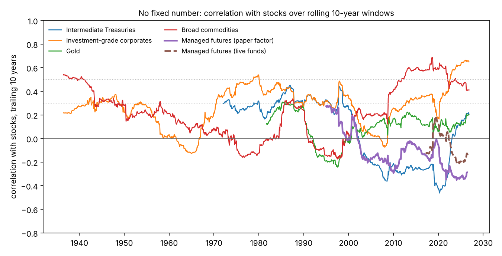

# Which assets have diversified stocks?

*Descriptive diversifier study; it measures the past on data that were all seen before it was designed, selects nothing and is not out-of-sample evidence.*

Written by `python -m assetforecast.diversifiers`; returns through 2026-10-31. Stocks are the world-stock composite of the three-fund restatement (US stocks only before 1975). Returns are monthly, over T-bills. Managed futures are not one of the package's 12 assets; they enter here from `data/sources/managed_futures.py` as a paper trend-following factor (AQR, 1985 on, before fees and costs) and as a composite of 9 live funds (2007 on, after fees, survivors only).

## Verdict on each asset's whole history

Thresholds, fixed before the tables were computed: correlation at most 0.3 at 1 and 12 months; never above 0.5 over any 10 years; in stocks' bear markets (falls of 20% or more) the asset loses at most 20% of what stocks lose; and a positive return of its own after its stock exposure is removed (alpha).

| Asset | From | Corr 1m | Corr 12m | Range over 10y | Share of stocks' bear-market loss | Bear markets it fell in | Alpha a year (t) | Verdict |
|---|---|---|---|---|---|---|---|---|
| Intermediate Treasuries | 1962 | +0.11 | +0.08 | -0.46 to +0.45 | -2% | 5 of 10 (worst -16%) | +1.4% (+1.4) | **diversifier (unproven)** |
| Long Treasuries | 1962 | +0.09 | +0.10 | -0.52 to +0.51 | +1% | 5 of 10 (worst -30%) | +1.6% (+1.1) | **unreliable** |
| TIPS | 1997 | +0.23 | +0.05 | -0.23 to +0.56 | -5% | 2 of 5 (worst -14%) | +1.9% (+1.2) | **unreliable** |
| Investment-grade corporates | 1926 | +0.27 | +0.25 | -0.13 to +0.66 | +5% | 7 of 17 (worst -22%) | +1.2% (+1.8) | **unreliable** |
| High-yield corporates | 1980 | +0.67 | +0.69 | +0.45 to +0.85 | +33% | 8 of 8 (worst -29%) | +0.8% (+0.7) | **stock-like** |
| US REITs | 1972 | +0.65 | +0.65 | +0.27 to +0.81 | +69% | 8 of 9 (worst -65%) | +2.5% (+1.3) | **stock-like** |
| Gold | 1971 | +0.10 | +0.02 | -0.24 to +0.32 | -2% | 3 of 9 (worst -56%) | +4.9% (+1.4) | **diversifier (unproven)** |
| Broad commodities | 1926 | +0.32 | +0.37 | -0.17 to +0.69 | +21% | 8 of 17 (worst -72%) | +2.3% (+1.2) | **stock-like** |
| Managed futures: paper trend factor, before fees | 1985 | -0.08 | -0.18 | -0.35 to +0.28 | -45% | 2 of 7 (worst -9%) | +12.8% (+5.6) | **diversifier** |
| Managed futures: paper trend factor, less measured drag | 1985 | -0.08 | -0.18 | -0.35 to +0.28 | -39% | 2 of 7 (worst -10%) | +10.2% (+4.5) | **diversifier** |
| Managed futures: live funds, after fees | 2007 | -0.13 | -0.10 | -0.21 to +0.19 | -19% | 1 of 4 (worst -7%) | +2.5% (+2.8) | **diversifier** |

"Share of stocks' bear-market loss": the asset's summed return over all bear-market months in its history divided by stocks' summed return over the same months; negative means it rose while stocks fell. That sum lets a gain in one bear market offset a loss in another; "Bear markets it fell in" counts them one by one (all are listed at the end). Windows differ by asset, so rows are not like for like; the common-window tables below are.

## Managed futures: paper against live

On the 231 months both series exist, the live funds ran at 0.63 times the paper factor's volatility and earned 1.7% a year less than the factor scaled to that volatility. At the factor's own volatility that is a drag of 2.7% a year (fees, trading costs, and whatever the paper rules flatter). The "less measured drag" row subtracts it from every month of the paper factor. Their monthly correlation with each other is 0.66.

## Common window from 1985

502 months, to 2026-10-31 (the paper trend factor ends 2026-05-31).

| Asset | Corr 1m | Corr 12m | Corr when stocks fall | Mean month in stocks' worst 10% | Share of bear-market loss | Return a year | Vol | Alpha a year (t) | Verdict |
|---|---|---|---|---|---|---|---|---|---|
| Intermediate Treasuries | +0.01 | -0.11 | -0.12 | +0.5% | -13% | +2.9% | 6.7% | +3.1% (+2.4) | diversifier |
| Long Treasuries | -0.00 | -0.06 | -0.08 | +0.6% | -14% | +3.5% | 12.2% | +4.2% (+2.2) | diversifier |
| Investment-grade corporates | +0.35 | +0.24 | +0.22 | -1.1% | +7% | +3.0% | 6.9% | +1.9% (+1.6) | stock-like |
| High-yield corporates | +0.69 | +0.71 | +0.68 | -3.1% | +36% | +3.4% | 8.1% | +0.7% (+0.7) | stock-like |
| US REITs | +0.64 | +0.61 | +0.63 | -6.4% | +71% | +5.9% | 18.1% | +1.4% (+0.6) | stock-like |
| Gold | +0.08 | +0.11 | -0.00 | +0.5% | -7% | +2.7% | 15.4% | +3.2% (+0.9) | diversifier (unproven) |
| Broad commodities | +0.32 | +0.38 | +0.26 | -2.0% | +24% | +1.5% | 14.4% | +0.1% (+0.0) | stock-like |
| Managed futures: paper trend factor, before fees | -0.08 | -0.18 | -0.12 | +1.8% | -45% | +11.4% | 12.4% | +12.8% (+5.6) | diversifier |
| Managed futures: paper trend factor, less measured drag | -0.08 | -0.18 | -0.12 | +1.5% | -39% | +8.8% | 12.4% | +10.2% (+4.5) | diversifier |

Stocks' own mean in their worst 10% of months: -8.3%.

What a 20% holding did to an all-stock portfolio (growth is over T-bills, a year):

|  | Growth | Vol | Sharpe | Worst fall |
|---|---|---|---|---|
| All stocks | +7.2% | 15.2% | +0.47 | -54% |
| Cash (T-bills) | +6.0% | 12.2% | +0.49 | -45% |
| Intermediate Treasuries | +6.6% | 12.2% | +0.54 | -44% |
| Long Treasuries | +6.8% | 12.4% | +0.55 | -43% |
| Investment-grade corporates | +6.6% | 12.7% | +0.52 | -46% |
| High-yield corporates | +6.6% | 13.3% | +0.49 | -49% |
| US REITs | +7.2% | 14.8% | +0.48 | -56% |
| Gold | +6.8% | 12.7% | +0.53 | -43% |
| Broad commodities | +6.3% | 13.4% | +0.47 | -51% |
| Managed futures: paper trend factor, before fees | +8.4% | 12.2% | +0.69 | -42% |
| Managed futures: paper trend factor, less measured drag | +7.9% | 12.2% | +0.65 | -42% |

80% stocks, 20% the asset, rebalanced monthly. Every row uses the same 497 months, 1985-01-31 to 2026-05-31.

## Common window from March 2007 (live funds exist)

236 months, to 2026-10-31 (the paper trend factor ends 2026-05-31).

| Asset | Corr 1m | Corr 12m | Corr when stocks fall | Mean month in stocks' worst 10% | Share of bear-market loss | Return a year | Vol | Alpha a year (t) | Verdict |
|---|---|---|---|---|---|---|---|---|---|
| Intermediate Treasuries | -0.05 | -0.22 | -0.02 | +0.8% | -11% | +1.5% | 6.7% | +1.9% (+1.0) | diversifier (unproven) |
| Long Treasuries | -0.07 | -0.20 | -0.03 | +1.4% | -17% | +1.1% | 14.0% | +2.6% (+0.8) | diversifier (unproven) |
| TIPS | +0.38 | +0.29 | +0.41 | -0.8% | +6% | +1.7% | 5.8% | +0.8% (+0.5) | stock-like |
| Investment-grade corporates | +0.49 | +0.43 | +0.37 | -1.9% | +20% | +2.3% | 8.2% | +0.6% (+0.3) | stock-like |
| High-yield corporates | +0.79 | +0.83 | +0.79 | -4.5% | +46% | +3.2% | 10.1% | -0.3% (-0.2) | stock-like |
| US REITs | +0.77 | +0.79 | +0.76 | -10.3% | +119% | +3.4% | 22.7% | -2.5% (-1.0) | stock-like |
| Gold | +0.16 | +0.10 | +0.05 | +0.2% | -7% | +7.0% | 17.4% | +7.3% (+1.7) | diversifier |
| Broad commodities | +0.51 | +0.60 | +0.43 | -4.9% | +59% | -0.9% | 16.6% | -3.5% (-0.9) | stock-like |
| Managed futures: paper trend factor, before fees | -0.21 | -0.42 | -0.17 | +1.8% | -37% | +5.1% | 13.3% | +7.4% (+3.9) | diversifier |
| Managed futures: paper trend factor, less measured drag | -0.21 | -0.42 | -0.17 | +1.6% | -32% | +2.4% | 13.3% | +4.8% (+2.5) | diversifier |
| Managed futures: live funds, after fees | -0.13 | -0.10 | -0.31 | +1.0% | -19% | +1.6% | 8.3% | +2.5% (+2.8) | diversifier |

Stocks' own mean in their worst 10% of months: -9.0%.

What a 20% holding did to an all-stock portfolio (growth is over T-bills, a year):

|  | Growth | Vol | Sharpe | Worst fall |
|---|---|---|---|---|
| All stocks | +6.9% | 16.3% | +0.42 | -54% |
| Cash (T-bills) | +5.7% | 13.0% | +0.44 | -45% |
| Intermediate Treasuries | +6.1% | 13.0% | +0.47 | -44% |
| Long Treasuries | +6.2% | 13.1% | +0.47 | -43% |
| TIPS | +6.1% | 13.5% | +0.45 | -45% |
| Investment-grade corporates | +6.2% | 13.9% | +0.45 | -46% |
| High-yield corporates | +6.3% | 14.7% | +0.43 | -49% |
| US REITs | +6.4% | 16.8% | +0.38 | -56% |
| Gold | +7.5% | 13.9% | +0.54 | -43% |
| Broad commodities | +5.5% | 15.0% | +0.37 | -51% |
| Managed futures: paper trend factor, before fees | +7.0% | 12.7% | +0.55 | -42% |
| Managed futures: paper trend factor, less measured drag | +6.4% | 12.7% | +0.51 | -42% |
| Managed futures: live funds, after fees | +6.1% | 12.8% | +0.48 | -44% |

80% stocks, 20% the asset, rebalanced monthly. Every row uses the same 231 months, 2007-03-31 to 2026-05-31.

## Every bear market in stocks

Month-end peak to trough of stocks over T-bills, falls of 20% or more (a fall ends when stocks have risen 20% from the low). Each cell is that asset's return over T-bills across the same months; blank where the asset's history does not cover it.

| Peak to trough | Stocks | Tsy 7y | Tsy long | TIPS | IG | HY | REITs | Gold | Cmdty | MF paper | MF funds |
|---|---|---|---|---|---|---|---|---|---|---|---|
| 1929-08 to 1932-06 | -84% |  |  |  | +2% |  |  |  | -72% |  |  |
| 1932-08 to 1933-02 | -31% |  |  |  | +4% |  |  |  | -32% |  |  |
| 1937-02 to 1938-03 | -50% |  |  |  | +2% |  |  |  | -24% |  |  |
| 1939-09 to 1940-05 | -22% |  |  |  | +3% |  |  |  | +3% |  |  |
| 1941-07 to 1942-04 | -23% |  |  |  | +1% |  |  |  | +11% |  |  |
| 1946-05 to 1947-05 | -24% |  |  |  | +1% |  |  |  | +35% |  |  |
| 1961-11 to 1962-06 | -24% |  |  |  | +2% |  |  |  | -4% |  |  |
| 1968-11 to 1970-06 | -39% | -11% | -17% |  | -14% |  |  |  | +9% |  |  |
| 1972-12 to 1974-09 | -52% | -10% | -17% |  | -16% |  | -40% | +102% | +144% |  |  |
| 1980-11 to 1982-07 | -33% | -4% | -8% |  | -3% | -4% | -20% | -56% | -39% |  |  |
| 1987-08 to 1987-11 | -26% | +1% | +1% |  | +0% | -5% | -14% | +7% | +5% | -3% |  |
| 1989-12 to 1990-09 | -22% | -4% | -9% |  | -4% | -13% | -18% | -4% | +13% | +21% |  |
| 2000-03 to 2002-09 | -49% | +25% | +23% | +25% | +18% | -9% | +31% | +6% | +8% | +65% |  |
| 2007-10 to 2009-02 | -55% | +15% | +17% | -1% | -7% | -29% | -65% | +15% | -42% | +30% | +10% |
| 2011-04 to 2011-09 | -20% | +13% | +31% | +6% | +4% | -8% | -16% | +4% | -20% | -9% | -7% |
| 2019-12 to 2020-03 | -22% | +10% | +22% | +1% | -3% | -12% | -24% | +3% | -24% | +12% | +3% |
| 2021-12 to 2022-09 | -26% | -16% | -30% | -14% | -22% | -16% | -30% | -10% | +13% | +34% | +28% |

## An equal-weight sleeve of the three that passed

Intermediate Treasuries, gold and managed futures, a third each, rebalanced monthly; the stock share is then chosen separately. From 1985 managed futures are the paper factor less the measured drag; from March 2007 they are the live funds, which is the window to trust. The three were picked on this same history, so every number below is flattered by that choice.

### 1985-01 to 2026-05 (497 months)

| Correlation | Stocks | Treasuries | Gold | Managed futures |
|---|---|---|---|---|
| Stocks | +1.00 | +0.00 | +0.08 | -0.08 |
| Treasuries | +0.00 | +1.00 | +0.15 | +0.20 |
| Gold | +0.08 | +0.15 | +1.00 | +0.06 |
| Managed futures | -0.08 | +0.20 | +0.06 | +1.00 |

|  | Treasuries / gold / managed futures | Growth | Vol | Sharpe | Corr with stocks | Stock bear markets it fell in |
|---|---|---|---|---|---|---|
| Sleeve, a third each | 33% / 33% / 33% | +5.4% | 7.6% | +0.71 | +0.00 | 0 of 7 (worst +0%) |
| Sleeve, by 1/volatility | 51% / 22% / 27% | +5.0% | 6.6% | +0.75 | -0.00 | 1 of 7 (worst -3%) |

| Equal-weight sleeve | Growth over T-bills | Vol | Sharpe | Worst fall |
|---|---|---|---|---|
| 100% stocks / 0% sleeve | +7.2% | 15.2% | +0.47 | -54% |
| 80% stocks / 20% sleeve | +7.1% | 12.2% | +0.58 | -43% |
| 60% stocks / 40% sleeve | +6.8% | 9.6% | +0.72 | -30% |
| 40% stocks / 60% sleeve | +6.5% | 7.6% | +0.86 | -17% |

### 2007-03 to 2026-10 (236 months)

| Correlation | Stocks | Treasuries | Gold | Managed futures |
|---|---|---|---|---|
| Stocks | +1.00 | -0.05 | +0.16 | -0.13 |
| Treasuries | -0.05 | +1.00 | +0.33 | -0.15 |
| Gold | +0.16 | +0.33 | +1.00 | +0.09 |
| Managed futures | -0.13 | -0.15 | +0.09 | +1.00 |

|  | Treasuries / gold / managed futures | Growth | Vol | Sharpe | Corr with stocks | Stock bear markets it fell in |
|---|---|---|---|---|---|---|
| Sleeve, a third each | 33% / 33% / 33% | +3.8% | 7.5% | +0.51 | +0.05 | 1 of 4 (worst -1%) |
| Sleeve, by 1/volatility | 46% / 18% / 37% | +2.9% | 5.8% | +0.50 | -0.02 | 1 of 4 (worst -0%) |

| Equal-weight sleeve | Growth over T-bills | Vol | Sharpe | Worst fall |
|---|---|---|---|---|
| 100% stocks / 0% sleeve | +6.6% | 16.1% | +0.41 | -54% |
| 80% stocks / 20% sleeve | +6.3% | 13.0% | +0.49 | -44% |
| 60% stocks / 40% sleeve | +5.9% | 10.2% | +0.57 | -32% |
| 40% stocks / 60% sleeve | +5.3% | 8.0% | +0.66 | -20% |

The sleeve lowers growth as well as risk: it earned less than stocks. The 1/volatility weights use each window's own volatility.

## What it costs to hold

Expense ratios looked up on 2026-11-16 (`data/processed/diversifier_vehicles.json`): a hand-recorded outside lookup, mostly from secondary sites. Confirm on the issuer's page before use.

| Fund | Name | Exposure | Holds | Fee a year | Fee read from | Note |
|---|---|---|---|---|---|---|
| IAUM | iShares Gold Trust Micro | gold | physical gold | 0.09% | secondary sites | cheapest gold fund found |
| GLDM | SPDR Gold MiniShares | gold | physical gold | 0.10% | secondary sites | much larger than IAUM, so easier to trade |
| GLD | SPDR Gold Shares | gold | physical gold | 0.40% | secondary sites | the panel's gold series |
| VGIT | Vanguard Intermediate-Term Treasury ETF | intermediate Treasuries | Treasuries, about 3 to 10 years | 0.03% | secondary sites | SCHR and SPTI charge the same; shorter than the panel's IEF (7 to 10 years) |
| SDMF | Simplify DBi CTA Managed Futures Index ETF | managed futures | futures and swaps tracking the DBi CTA Managed Futures Index | 0.21% | issuer page | launched 2026-02-17, about $52M; several aggregators still show 0.35%; not in the study's fund composite |
| WTMF | WisdomTree Managed Futures Strategy Fund | managed futures | futures | 0.66% | secondary sites | in the study's composite; the least volatile of its funds, and it lost money in 2022 |
| DBMF | iMGP DBi Managed Futures Strategy ETF | managed futures | futures replicating large managed-futures funds | 0.85% | secondary sites | since 2019; in the study's composite |
| KMLM | KraneShares Mount Lucas Managed Futures Index Strategy ETF | managed futures | futures | 0.90% | secondary sites | in the study's composite |

A third each in IAUM, VGIT and SDMF costs 0.11% a year; with DBMF, which has a record since 2019, 0.32%.

None of these funds is in the panel, and the study's returns are not theirs.

## Caveats

- The paper trend factor is a backtest of rules published in 2012. Its 1985-2011 return is what the rules would have earned before costs, not what anyone earned. The drag is estimated on one 231-month stretch and applied to all of it.
- The fund composite holds only funds alive today, which flatters its return. Its correlation with stocks is less exposed to that.
- Bear markets since 1985 number few; a share of bear-market loss rests on a handful of episodes.
- The thresholds are judgements. Each column is in `results/diversifiers/summary.csv` for anyone who would draw the lines elsewhere.
- Nothing here is a forecast. The published 12-month forecast still covers the 12 assets only.
