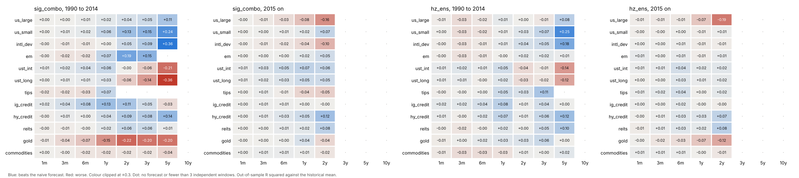
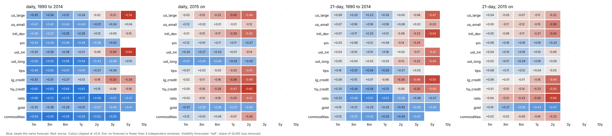
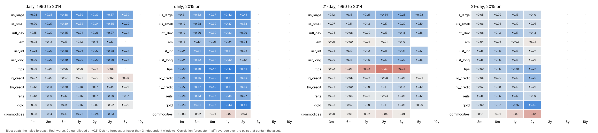

# Horizon study: what is predictable from 1 month to 10 years

> Descriptive horizon study; both holdouts were spent before it was designed, so no number here is out-of-sample evidence and nothing was selected on it.

Generated by `python -m assetforecast.horizons.run` (tables in `results/horizons/`, returns through 2026-10-31). The interactive version is `dashboard/horizons.html`.

## The short answer

**Returns: nothing reliable at any horizon, and a hint at 3 to 5 years that cannot be checked.** Up to 12 months the pooled out-of-sample R squared against the historical mean is -4.0% to +1.3% in 1990 to 2014 and -4.0% to +3.2% after 2015 across the 4 forecasters: noise around zero. In 1990 to 2014 it rises with the horizon for two of them (`hz_ridge` +6.8% at 3y, +7.3% at 5y; `hz_ens` +3.3% at 3y, +5.9% at 5y), mostly from equities, but that rests on about 4 to 7 non-overlapping windows, the years after 2015 are too few to confirm it, and a sleeve trading on `hz_ens` at those horizons earned -0.01% a year at 3y and -0.01% a year at 5y over the baseline. Cells where a forecaster beat the mean in both periods: `sig_combo` 26 of 59; `hz_ridge` 24 of 60; `hz_gbm` 11 of 60; `hz_ens` 20 of 60 (one in four would be expected from coin flips).

**Volatility is predictable out to about a year, and much less beyond.** With daily data the blended forecast (`half`) removes 48% to 53% of the naive forecast's loss at 1 to 12 months in 1990 to 2014 and 11% to 17% at 3 to 5 years. After 2015 the average gain disappears at most horizons (-13% to 9% at 1 to 12 months), yet the forecast still has the lower loss in 73% to 84% of months: the average is dominated by the windows that contain the crash of March 2020, when every forecast built on recent calm was far too low.

**Correlations are modestly predictable at every horizon up to about 3 years.** `half` removes 14% to 23% of the naive squared error in 1990 to 2014 and 22% to 35% after 2015 (daily measure), and unlike volatility this held up in both periods.

**Combining the two does not make the whole model better.** A sleeve that sizes each position with a return forecast and a volatility forecast gained -0.3% to +0.5% a year in certainty-equivalent return over the baseline in 1990 to 2014 and -0.2% to +0.2% after 2015, depending on the horizon (`sig_combo` with `half`): small, and with the sign changing between periods and horizons. The volatility regression `har` added +0.3% to +0.6% a year at 3 months to 5 years in 1990 to 2014 and -0.7% to +0.1% after 2015. What the study supports is a split: keep expected returns at the historical mean at every horizon, and treat risk as the forecastable part, mainly at short horizons.

## What was run

Horizons: 1m, 3m, 6m, 1y, 2y, 3y, 5y, 10y. Forecasts are made at every month end; a window is scored once it has closed. Two periods are shown side by side: **1990 to 2014** (origins from 1990-01 whose window closed by 2014-12, the years this package's models were developed on) and **2015 on** (the spent holdout years). Neither is a test. A cell with fewer than 3 non-overlapping windows is left blank; at 10 years that is every cell after 2015 and most cells before.

| quantity | forecasters | the bar | skill |
|---|---|---|---|
| return | `sig_combo` (mean of nine single-signal regressions: carry, value, momentum, trend, reversal, term spread, default spread, CAPE yield, bill rate) and the frozen learners re-aimed at each horizon under new names (`hz_ridge`, `hz_gbm`, `hz_ens`) | the expanding historical mean | out-of-sample R squared; Clark-West test |
| volatility | `trail_3/12/60` (last 3, 12, 60 months), `half` (mean of `trail_12` and the long-run level), `har` (log regression on the three trailing levels) | the long-run level of the asset's whole history | share of QLIKE loss removed; Diebold-Mariano test |
| correlation | `trail_12/36/60`, `half` (mean of `trail_36` and the long-run level) | the pair's long-run correlation | share of squared error removed; Diebold-Mariano test |

Check: at 12 months the re-aimed learners must reproduce the frozen forecasts. Largest absolute difference: `hz_ridge` vs `ridge_z` 0.0e+00 over 5107 rows, `hz_gbm` vs `gbm_z` 0.0e+00 over 5107 rows, `hz_ens` vs `ens_z` 0.0e+00 over 5107 rows.

Risk is measured two ways. The **21-day measure** is the package's target definition (overlapping 21-day returns; price sources agree at that span) but it is very noisy in short windows, which pulls measured skill toward zero. The **daily measure** is precise but depends on how each source is priced. Read them together.

## 1. Returns

Pooled out-of-sample R squared against the historical mean, 1990 to 2014:

| model | 1m | 3m | 6m | 1y | 2y | 3y | 5y | 10y |
|---|---|---|---|---|---|---|---|---|
| hz_ens | -0.3% | -2.1% | -1.1% | +1.1% | +1.5% | +3.3% | +5.9% |  |
| hz_gbm | -0.0% | -0.8% | -0.2% | +0.9% | -0.9% | -1.1% | -0.6% |  |
| hz_ridge | -1.6% | -4.0% | -3.5% | -1.1% | +5.3% | +6.8% | +7.3% |  |
| sig_combo | -0.2% | -0.7% | -0.7% | +1.3% | +3.2% | +2.3% | -0.4% |  |

Clark-West one-sided p-value (model better), 1990 to 2014; not adjusted for the 28 cells:

| model | 1m | 3m | 6m | 1y | 2y | 3y | 5y | 10y |
|---|---|---|---|---|---|---|---|---|
| hz_ens | 0.34 | 0.88 | 0.60 | 0.16 | 0.10 | 0.05 | 0.00 |  |
| hz_gbm | 0.15 | 0.90 | 0.49 | 0.10 | 0.79 | 0.71 | 0.45 |  |
| hz_ridge | 0.64 | 0.89 | 0.80 | 0.32 | 0.05 | 0.05 | 0.01 |  |
| sig_combo | 0.50 | 0.59 | 0.48 | 0.09 | 0.12 | 0.17 | 0.18 |  |

Pooled out-of-sample R squared against the historical mean, 2015 on:

| model | 1m | 3m | 6m | 1y | 2y | 3y | 5y | 10y |
|---|---|---|---|---|---|---|---|---|
| hz_ens | +0.1% | +0.0% | +0.7% | -1.2% | -2.3% |  |  |  |
| hz_gbm | +0.0% | -0.1% | +0.1% | -4.0% | -1.1% |  |  |  |
| hz_ridge | -0.1% | +0.3% | +1.8% | +3.2% | +2.2% |  |  |  |
| sig_combo | +0.1% | +0.3% | +0.5% | +1.1% | +0.4% |  |  |  |

Clark-West one-sided p-value (model better), 2015 on; not adjusted for the 20 cells:

| model | 1m | 3m | 6m | 1y | 2y | 3y | 5y | 10y |
|---|---|---|---|---|---|---|---|---|
| hz_ens | 0.31 | 0.38 | 0.23 | 0.75 | 0.66 |  |  |  |
| hz_gbm | 0.32 | 0.51 | 0.41 | 0.95 | 0.87 |  |  |  |
| hz_ridge | 0.36 | 0.20 | 0.11 | 0.14 | 0.23 |  |  |  |
| sig_combo | 0.16 | 0.11 | 0.10 | 0.03 | 0.26 |  |  |  |

Horizons at which a forecaster beat the historical mean in **both** periods, by asset (a description; with this many cells some agreement is expected by chance):

| asset | `sig_combo` | `hz_ridge` | `hz_gbm` | `hz_ens` |
|---|---|---|---|---|
| us_large | none | none | none | none |
| us_small | 1m, 3m, 6m, 1y, 2y | 2y | none | 2y |
| intl_dev | none | 1y, 2y | none | none |
| em | 1y, 2y | 2y | none | 2y |
| ust_int | 1m, 3m, 6m, 1y | 1m, 3m, 6m, 1y, 2y | 1m, 3m, 6m | 1m, 3m, 6m, 1y |
| ust_long | 1m, 3m, 6m, 1y | 1m, 3m, 1y, 2y | 1m, 3m, 6m | 1m, 3m, 1y |
| tips | none | 1y, 2y | none | 6m, 1y, 2y |
| ig_credit | 1m, 3m, 6m, 1y | 1m, 3m, 6m, 1y, 2y | 1m, 3m, 6m | 1m, 3m, 6m |
| hy_credit | 3m, 6m, 1y, 2y | 6m, 1y, 2y | 6m | 6m, 1y, 2y |
| reits | 1y, 2y | 2y | 6m | 1y, 2y |
| gold | none | none | none | none |
| commodities | 1m | none | none | none |

The single signals, pooled R squared, 1990 to 2014:

| signal | 1m | 3m | 6m | 1y | 2y | 3y | 5y | 10y |
|---|---|---|---|---|---|---|---|---|
| sig_carry | -1.3% | -2.7% | -3.8% | -5.3% | -11.3% | -19.6% | -18.2% |  |
| sig_g_default_spread | -1.9% | -5.6% | -9.1% | -10.8% | -15.5% | -32.9% | -53.9% |  |
| sig_g_tbill | -1.3% | -3.1% | -4.7% | -6.8% | -13.3% | -26.5% | -27.9% |  |
| sig_g_term_spread | -0.2% | -0.5% | -0.6% | +3.1% | +13.1% | +12.1% | +3.3% |  |
| sig_g_us_cape_ey_z | -0.6% | -1.7% | -2.6% | -7.9% | -15.5% | -19.9% | -31.6% |  |
| sig_lt_rev_60_12 | +0.1% | -0.3% | -0.3% | +2.0% | +0.5% | -10.3% | -15.0% |  |
| sig_mom_12_1 | -0.6% | -1.6% | -2.6% | -2.6% | -1.8% | +0.4% | +6.3% |  |
| sig_trend_ma10 | -0.7% | -1.2% | -2.0% | -2.5% | -1.1% | +0.2% | +2.7% |  |
| sig_value | -2.3% | -8.7% | -13.2% | -31.8% | -43.2% | -37.2% | -28.7% |  |

and 2015 on:

| signal | 1m | 3m | 6m | 1y | 2y | 3y | 5y | 10y |
|---|---|---|---|---|---|---|---|---|
| sig_carry | -0.3% | -0.8% | -2.6% | -3.7% | -4.9% |  |  |  |
| sig_g_default_spread | +0.3% | +0.6% | +1.5% | +4.5% | +7.7% |  |  |  |
| sig_g_tbill | -0.6% | -1.7% | -3.7% | -6.4% | -12.2% |  |  |  |
| sig_g_term_spread | -0.3% | -1.2% | -2.8% | -11.6% | -36.3% |  |  |  |
| sig_g_us_cape_ey_z | +0.1% | -0.1% | -1.0% | -1.7% | -2.8% |  |  |  |
| sig_lt_rev_60_12 | -0.0% | -0.3% | -0.6% | -2.7% | -5.4% |  |  |  |
| sig_mom_12_1 | -0.2% | -0.7% | -0.9% | +1.7% | +3.1% |  |  |  |
| sig_trend_ma10 | -0.5% | -0.4% | -0.8% | -0.1% | +1.5% |  |  |  |
| sig_value | +0.1% | +0.5% | +1.7% | +1.7% | -3.2% |  |  |  |

## 2. Volatility

Share of the naive forecast's QLIKE loss removed, pooled, daily measure, 1990 to 2014:

| model | 1m | 3m | 6m | 1y | 2y | 3y | 5y | 10y |
|---|---|---|---|---|---|---|---|---|
| half | 48% | 52% | 53% | 52% | 29% | 17% | 11% |  |
| har | 57% | 48% | 31% | -8% | -69% | -42% | -96% |  |
| trail_12 | 55% | 58% | 58% | 53% | -2% | -30% | -36% |  |
| trail_3 | 58% | 55% | 52% | 50% | -0% | -53% | -71% |  |
| trail_60 | 27% | 27% | 27% | 24% | 15% | 19% | 23% |  |

Share of the naive forecast's QLIKE loss removed, pooled, daily measure, 2015 on:

| model | 1m | 3m | 6m | 1y | 2y | 3y | 5y | 10y |
|---|---|---|---|---|---|---|---|---|
| half | 9% | 2% | -3% | -13% | -22% |  |  |  |
| har | 17% | -7% | -9% | -18% | -18% |  |  |  |
| trail_12 | -10% | -37% | -51% | -89% | -154% |  |  |  |
| trail_3 | 6% | -52% | -76% | -124% | -232% |  |  |  |
| trail_60 | -7% | -14% | -20% | -31% | -51% |  |  |  |

Share of months on which `half` had the lower loss than naive, daily measure:

| period | 1m | 3m | 6m | 1y | 2y | 3y | 5y | 10y |
|---|---|---|---|---|---|---|---|---|
| 1990 to 2014 | 85% | 87% | 88% | 89% | 83% | 76% | 70% |  |
| 2015 on | 84% | 82% | 77% | 73% | 50% |  |  |  |

Share of the naive forecast's QLIKE loss removed, pooled, 21-day measure, 1990 to 2014:

| model | 1m | 3m | 6m | 1y | 2y | 3y | 5y | 10y |
|---|---|---|---|---|---|---|---|---|
| half | 10% | 25% | 28% | 27% | 13% | 3% | -2% |  |
| har | -27% | 22% | 19% | 1% | -13% | -24% | -49% |  |
| published |  |  |  | 32% |  |  |  |  |
| trail_12 | 10% | 22% | 22% | 14% | -47% | -101% | -124% |  |
| trail_3 | -9% | -36% | -57% | -69% | -165% | -314% | -405% |  |
| trail_60 | 4% | 3% | -1% | -7% | -9% | -5% | 3% |  |

Share of the naive forecast's QLIKE loss removed, pooled, 21-day measure, 2015 on:

| model | 1m | 3m | 6m | 1y | 2y | 3y | 5y | 10y |
|---|---|---|---|---|---|---|---|---|
| half | 4% | 0% | -1% | -7% | -20% |  |  |  |
| har | -29% | -7% | -10% | -15% | -24% |  |  |  |
| published |  |  |  | -9% |  |  |  |  |
| trail_12 | -5% | -47% | -54% | -83% | -193% |  |  |  |
| trail_3 | -27% | -128% | -216% | -284% | -512% |  |  |  |
| trail_60 | 1% | -19% | -28% | -42% | -75% |  |  |  |

Share of months on which `half` had the lower loss than naive, 21-day measure:

| period | 1m | 3m | 6m | 1y | 2y | 3y | 5y | 10y |
|---|---|---|---|---|---|---|---|---|
| 1990 to 2014 | 75% | 79% | 80% | 81% | 78% | 72% | 70% |  |
| 2015 on | 73% | 76% | 75% | 71% | 50% |  |  |  |

`published` is the selected model `combo_cov_main`, scored here at its own 12-month horizon for reference. `har` is unstable beyond 2 years: there are too few closed windows to fit it.

## 3. Correlations

Share of the naive squared error removed, pooled over pairs, daily measure, 1990 to 2014:

| model | 1m | 3m | 6m | 1y | 2y | 3y | 5y | 10y |
|---|---|---|---|---|---|---|---|---|
| half | 14% | 20% | 23% | 22% | 23% | 23% | 17% |  |
| trail_12 | 23% | 30% | 30% | 23% | 15% | 16% | 5% |  |
| trail_36 | 15% | 21% | 22% | 19% | 20% | 23% | 15% |  |
| trail_60 | 12% | 18% | 21% | 22% | 24% | 24% | 15% |  |

Share of the naive squared error removed, pooled over pairs, daily measure, 2015 on:

| model | 1m | 3m | 6m | 1y | 2y | 3y | 5y | 10y |
|---|---|---|---|---|---|---|---|---|
| half | 22% | 30% | 34% | 35% | 31% |  |  |  |
| trail_12 | 30% | 38% | 38% | 39% | 32% |  |  |  |
| trail_36 | 27% | 37% | 40% | 39% | 31% |  |  |  |
| trail_60 | 22% | 31% | 34% | 31% | 19% |  |  |  |

Share of the naive squared error removed, pooled over pairs, 21-day measure, 1990 to 2014:

| model | 3m | 6m | 1y | 2y | 3y | 5y | 10y |
|---|---|---|---|---|---|---|---|
| half | 5% | 8% | 9% | 11% | 14% | 11% |  |
| published |  |  | 9% |  |  |  |  |
| trail_12 | -5% | -11% | -29% | -54% | -57% | -68% |  |
| trail_36 | 1% | 2% | -3% | -5% | -2% | -8% |  |
| trail_60 | 3% | 5% | 6% | 7% | 7% | -0% |  |

Share of the naive squared error removed, pooled over pairs, 21-day measure, 2015 on:

| model | 3m | 6m | 1y | 2y | 3y | 5y | 10y |
|---|---|---|---|---|---|---|---|
| half | 7% | 11% | 12% | 10% |  |  |  |
| published |  |  | 14% |  |  |  |  |
| trail_12 | -6% | -15% | -32% | -48% |  |  |  |
| trail_36 | 1% | 1% | -6% | -14% |  |  |  |
| trail_60 | 1% | 2% | -2% | -14% |  |  |  |

## 4. Is it worth money?

Single-asset sleeves against cash (risk aversion 5, weight between 0 and 1.5, the package's trading costs and financing spread). Each forecast is held for its own horizon. Gain in annualized certainty-equivalent return over the baseline (historical mean, long-run volatility), equal-weight average of the 12 sleeves:

1990 to 2014:

| return / volatility forecast | 1m | 3m | 6m | 1y | 2y | 3y | 5y | 10y |
|---|---|---|---|---|---|---|---|---|
| hist_mean / half | +0.1% | +0.0% | +0.0% | -0.0% | -0.1% | -0.1% | -0.0% |  |
| hist_mean / har | -1.0% | +0.3% | +0.4% | +0.5% | +0.6% | +0.6% | +0.4% |  |
| hist_mean / naive |  |  |  |  |  |  |  |  |
| hz_ens / half | +0.8% | +0.0% | +0.0% | +0.1% | -0.2% | -0.1% | -0.1% |  |
| hz_ens / har | -0.7% | -0.0% | +0.3% | +0.5% | +0.4% | +0.5% | +0.3% |  |
| hz_ens / naive | +0.4% | -0.3% | -0.0% | +0.2% | -0.1% | -0.0% | -0.0% |  |
| sig_combo / half | +0.5% | +0.3% | +0.3% | +0.1% | -0.1% | -0.1% | -0.3% |  |
| sig_combo / har | -0.9% | +0.3% | +0.4% | +0.6% | +0.4% | +0.3% | +0.2% |  |
| sig_combo / naive | +0.4% | +0.3% | +0.2% | +0.2% | +0.1% | -0.0% | -0.2% |  |

t-statistic of the gain:

| return / volatility forecast | 1m | 3m | 6m | 1y | 2y | 3y | 5y | 10y |
|---|---|---|---|---|---|---|---|---|
| hist_mean / half | +0.31 | +0.17 | +0.06 | -0.14 | -0.36 | -0.33 | -0.23 |  |
| hist_mean / har | -1.62 | +0.99 | +1.44 | +2.56 | +3.76 | +3.70 | +1.88 |  |
| hist_mean / naive |  |  |  |  |  |  |  |  |
| hz_ens / half | +1.67 | +0.05 | +0.12 | +0.38 | -1.58 | -1.67 | -1.16 |  |
| hz_ens / har | -1.01 | -0.06 | +0.80 | +1.93 | +3.38 | +4.91 | +2.65 |  |
| hz_ens / naive | +0.89 | -0.70 | -0.01 | +0.73 | -0.70 | -0.03 | -0.12 |  |
| sig_combo / half | +1.34 | +1.02 | +1.03 | +0.49 | -0.51 | -1.25 | -4.05 |  |
| sig_combo / har | -1.45 | +0.76 | +1.02 | +1.44 | +1.24 | +1.00 | +1.26 |  |
| sig_combo / naive | +1.51 | +0.96 | +0.89 | +0.67 | +0.28 | -0.21 | -1.43 |  |

2015 on:

| return / volatility forecast | 1m | 3m | 6m | 1y | 2y | 3y | 5y | 10y |
|---|---|---|---|---|---|---|---|---|
| hist_mean / half | -0.4% | -0.3% | -0.2% | -0.1% | +0.3% | +0.3% |  |  |
| hist_mean / har | -0.7% | -0.4% | -0.2% | -0.1% | +0.1% | +0.1% |  |  |
| hist_mean / naive |  |  |  |  |  |  |  |  |
| hz_ens / half | -0.3% | -0.4% | -0.1% | -0.2% | +0.0% | +0.2% |  |  |
| hz_ens / har | -0.7% | -0.4% | -0.0% | -0.1% | -0.1% | -0.0% |  |  |
| hz_ens / naive | +0.2% | -0.0% | +0.1% | -0.1% | -0.2% | -0.1% |  |  |
| sig_combo / half | -0.2% | -0.1% | -0.1% | -0.1% | +0.2% | +0.2% |  |  |
| sig_combo / har | -0.6% | -0.2% | -0.0% | -0.0% | +0.1% | +0.1% |  |  |
| sig_combo / naive | +0.2% | +0.1% | +0.1% | +0.1% | -0.0% | -0.0% |  |  |

t-statistic of the gain:

| return / volatility forecast | 1m | 3m | 6m | 1y | 2y | 3y | 5y | 10y |
|---|---|---|---|---|---|---|---|---|
| hist_mean / half | -0.98 | -0.83 | -0.64 | -0.25 | +2.83 | +4.19 |  |  |
| hist_mean / har | -1.10 | -0.77 | -0.43 | -0.18 | +0.95 | +1.46 |  |  |
| hist_mean / naive |  |  |  |  |  |  |  |  |
| hz_ens / half | -0.59 | -1.28 | -0.40 | -0.68 | +0.27 | +2.36 |  |  |
| hz_ens / har | -0.96 | -1.09 | -0.16 | -0.63 | -0.60 | -0.62 |  |  |
| hz_ens / naive | +0.29 | -0.16 | +0.71 | -0.68 | -1.40 | -1.31 |  |  |
| sig_combo / half | -0.44 | -0.44 | -0.31 | -0.23 | +1.55 | +3.32 |  |  |
| sig_combo / har | -0.88 | -0.42 | -0.06 | -0.08 | +0.84 | +1.76 |  |  |
| sig_combo / naive | +0.82 | +0.69 | +0.61 | +0.30 | -0.33 | -0.40 |  |  |

Long-only minimum-variance portfolio built from forecast volatilities and correlations; realized volatility relative to the same portfolio built from the naive forecasts (below 1: the forecasts lowered risk):

1990 to 2014:

| volatility / correlation forecast | 3m | 6m | 1y | 2y | 3y | 5y | 10y |
|---|---|---|---|---|---|---|---|
| half / half | 0.946 | 0.944 | 0.955 | 0.986 | 1.005 | 1.014 |  |
| half / naive | 0.953 | 0.954 | 0.965 | 0.996 | 1.012 | 1.027 |  |
| half / published |  |  |  |  |  |  |  |
| naive / half | 0.998 | 0.994 | 0.994 | 0.997 | 0.997 | 0.992 |  |
| naive / naive |  |  |  |  |  |  |  |
| naive / published |  |  |  |  |  |  |  |
| published / half |  |  |  |  |  |  |  |
| published / naive |  |  |  |  |  |  |  |
| published / published |  |  | 0.946 |  |  |  |  |

2015 on:

| volatility / correlation forecast | 3m | 6m | 1y | 2y | 3y | 5y | 10y |
|---|---|---|---|---|---|---|---|
| half / half | 1.019 | 1.021 | 1.022 | 1.032 |  |  |  |
| half / naive | 1.037 | 1.033 | 1.026 | 1.028 |  |  |  |
| half / published |  |  |  |  |  |  |  |
| naive / half | 0.995 | 0.999 | 1.004 | 1.010 |  |  |  |
| naive / naive |  |  |  |  |  |  |  |
| naive / published |  |  |  |  |  |  |  |
| published / half |  |  |  |  |  |  |  |
| published / naive |  |  |  |  |  |  |  |
| published / published |  |  | 1.028 |  |  |  |  |

## 5. The map by asset

Horizons with positive skill in both periods, per asset. Nothing is picked from this table; it shows where the two periods agree.

| asset | return (`sig_combo`) | volatility (`half`, daily) | volatility (`half`, 21-day) | correlation (`half`, daily) | correlation (`half`, 21-day) |
|---|---|---|---|---|---|
| us_large | none | none | 1m | 1m, 3m, 6m, 1y, 2y | 3m, 6m, 1y, 2y |
| us_small | 1m, 3m, 6m, 1y, 2y | 1m, 3m, 6m | 1m | 1m, 3m, 6m, 1y, 2y | 3m, 6m, 1y, 2y |
| intl_dev | none | none | 1m | 1m, 3m, 6m, 1y, 2y | 3m, 6m, 1y, 2y |
| em | 1y, 2y | 1m, 3m, 6m, 1y, 2y | 1m, 3m, 6m, 1y | 1m, 3m, 6m, 1y, 2y | 6m |
| ust_int | 1m, 3m, 6m, 1y | 1m, 3m, 6m, 1y | 1m, 3m, 6m, 1y | 1m, 3m, 6m, 1y, 2y | 3m, 6m, 1y, 2y |
| ust_long | 1m, 3m, 6m, 1y | 1m, 3m, 6m, 1y, 2y | 1m, 3m, 6m, 1y | 1m, 3m, 6m, 1y, 2y | 3m, 6m, 1y, 2y |
| tips | none | 1m, 3m | 1m, 3m, 6m, 1y | 1m, 3m, 6m | none |
| ig_credit | 1m, 3m, 6m, 1y | none | 1m, 3m | 1m, 3m, 6m, 1y | 3m, 6m, 1y, 2y |
| hy_credit | 3m, 6m, 1y, 2y | 1m | 1m | 1m, 3m, 6m, 1y, 2y | 3m, 6m, 1y, 2y |
| reits | 1y, 2y | 1m | none | 1m, 3m, 6m, 1y, 2y | 3m, 6m, 1y, 2y |
| gold | none | 1m, 3m, 6m, 1y, 2y | 1m, 3m, 6m, 1y, 2y | 1m, 3m, 6m, 1y, 2y | 3m, 6m, 1y, 2y |
| commodities | 1m | 1m, 3m, 6m | 1m | 1m, 3m | none |

## Limits

- Both holdouts were spent before this study. The 2015 on columns are a description of years already seen, and the forecasters were chosen by someone who knew the literature on those years.
- Nothing is adjusted for the number of cells. With 12 assets, 8 horizons, several forecasters and two periods, isolated good cells are expected by chance.
- Long horizons have almost no independent evidence: 1990 to 2014 holds two and a half non-overlapping 10-year windows at best, and fewer once a model needs training data.
- QLIKE punishes forecasts that are too low much more than ones that are too high, so one crisis that follows a calm stretch (March 2020) dominates a 12-year average. The win rates are shown beside it for that reason.
- The daily risk measure shifts level where an asset's price source changes (`reports/data/horizon_evidence.md`); the 21-day measure does not, but is noisy.
- The sleeves hold each forecast to its horizon. An investor who re-forecasts every month would trade more and could do better or worse.
- The frozen models and the published 12-month forecast are unchanged. A model at a new horizon would have to be declared now and judged on forecasts made after `FROZEN_AT`; at 1 month that evidence accumulates 12 times faster than at 12.
